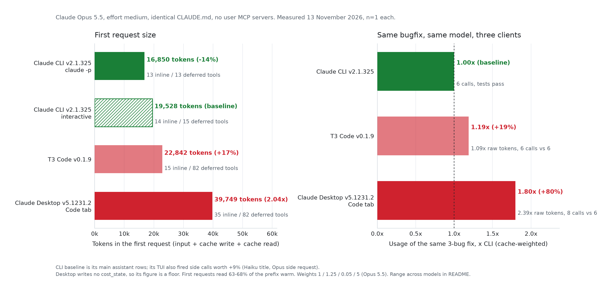

# Claude Code usage: fewer tokens is not less usage, and a pause can cost more than the work

**14 live Claude Opus 5.5 runs plus a 9-run cache-expiry test, read from the raw session logs.** One arm sent 63% fewer tokens and used 25.2% more. A warm session saved 27.7%. But come back to a big session after a 10-minute coffee break and the next quick fix used **about 10 times** as much as starting fresh with `/clear`. That held in 3 of 3 pairs.

> **Units.** Every change below is **cache-weighted usage**: tokens weighted the way the API meters them, on Opus 5.5 `1 / 1.25 / 2 / 0.05 / 5` (input / 5-minute cache write / 1-hour cache write / cache read / output).
> Read weights differ by model (0.1x on Sonnet 5 and Opus 4.7, 0.025x on Fable and Mythos), so each live result is also given across that range where it moves the answer.
> The subscription's five-hour and weekly meter is **not measured**. Anthropic does not publish its weights.

## Best Practices & Takeaways

| When | Do | Why | Evidence |
| --- | --- | --- | --- |
| Next task starts inside the cache window (5 min on an API key or credits, 1 hour on a subscription) and the history is small | Stay in the session | -27.7% usage (-21.1% to -32.0% by model). With 97k of history, even a warm resume used 1.5 times a fresh start | Live, n=1 each |
| You were away longer than the cache window | `/clear` and paste a 3-line handoff, unless history is under ~10k tokens | Resuming a 97k-token session after a 10-minute break used about 10 times a fresh `/clear` start on the same fix. The whole history is written to the cache again | Live, 3 pairs, n=1 each |
| Scheduled `claude -p` jobs (cron, CI) | Fresh session every run, state in a file, never `--resume` | Resuming every run costs about 3 times as much (fresh runs use 33% to 35% of it) | Modeled. The cold rebuild behind it was measured live (section 1) |
| Laptop sleeps or the terminal closes over lunch | Assume no idle compaction. `/compact` before you leave, or `/clear` with a handoff on return | Idle compaction needs a 1-hour cache, a live process, and 200,000+ tokens. Lapsed, the day costs +76% | Binary + modeled |
| Deep work heading past 300k tokens | One knob: `claude --autocompact 180000` | -43% modeled on Opus 5.5 (-57% at 0.1x reads). It fires at 147,000 | Modeled + binary |
| Sessions that end under ~270k with no pause past the cache window | Leave the default | Lower triggers tied or used 14% to 25.2% more | Live, n=1 |
| Tempted to set a window and a percentage | Don't | They multiply: 250,000 with 25 fires at 57,500 | Live + binary |
| Judging usage from the transcript | Don't | Up to 25.5% of usage was summary calls the transcript never shows | Live |
| Choosing a client | The CLI is leanest | T3 Code 1.19x, Desktop's Code tab 1.80x on the same fix | Live, n=1 |

Each rule is explained below, in this order: the pause tax, compaction measured live, the trigger math, three clients, the model and its sweet spots, copy-paste settings, and what is measured versus modeled.

## 1. The pause tax

**Rule: resume only while the cache is warm and the history is small. After a long pause, start fresh with a short handoff.**

Claude Code caches the prompt prefix. Inside the cache window a resumed session re-reads its whole history at the cheap read weight. After the window, every old token is written to the cache again at full write weight. The cache window is **5 minutes** on an API key or usage credits and **1 hour** on a subscription.

**Measured live: a coffee break made the next fix about 10 times as expensive.** We built a session up to about 97k tokens of context on Opus 5.5 (5-minute cache), walked away for 10 to 13 minutes, then resumed it for a quick bugfix. Each time we also did the same fix in a brand-new session, the same as `/clear`. Three different fixes, so three pairs, and every fix passed its tests.

| Same quick fix | Fresh session (`/clear`) | Resumed after 3.3 min (cache warm) | Resumed after 10+ min (cache expired) |
| --- | ---: | ---: | ---: |
| Usage, fresh = 1 | **1** | **1.5 times** | **9.8 to 9.9 times** (3 of 3 pairs) |
| Same across models' read prices | 1 | 1.0 to 2.3 times | 9.0 to 10.5 times |
| First call: tokens written to the cache | about 5,500 | 743 | 86,178 to 88,229 |
| First call: tokens read from the cache | 11,388 | 96,730 | 11,388 |
| Raw tokens for the whole fix | about 52,000 | 293,834 | 294,158 to 301,452 |
| Context at the end | about 17,800 | 98,303 | 98,439 to 101,067 |

What that means in plain terms:

- **After the break, the old session pays for its whole history again.** The first call wrote 86k to 88k tokens back into the cache at the full write price. The fresh session only had to write about 5,500.
- **The warm resume moved almost the same number of tokens as the stale one (294k) but used 6.5 times less.** Same tokens, different price: read from a warm cache instead of written again. Token counts alone would have called these two a tie.
- **Even warm, 97k of history was too much to carry into an unrelated small fix.** The warm resume still used 1.5 times a fresh start. The model below predicted about 1.4 times at that size, and says a warm resume only pays while history is under about 24k tokens.
- **Honest limits.** One hot run and three stale and fresh pairs, each run once, on one model and one kind of small task. The three pairs agreed within 2%, and the mechanism (a full cache rewrite after the window) showed up on every stale first call. A bigger next task would shrink the multiple, because the fresh session's own work would weigh more. The extra cost itself, about 1.4 units per carried token, does not shrink.


| Cache | Read weight | Rewrite weight | One old token after a pause |
| --- | ---: | ---: | ---: |
| 5 minutes | 0.1x | 1.25x | 12.5 times a warm read |
| 5 minutes | 0.05x (Opus 5.5) | 1.25x | 25 times |
| 1 hour | 0.1x | 2x | 20 times |
| 1 hour | 0.05x (Opus 5.5) | 2x | 40 times |


The chart models a 5-call next task (a ~17k system and project prefix, 2k of new input and 600 of output per call), 0.05x reads:

- **Stale `--resume`** (after the cache expired) pays 1.45 units per carried token on a 5-minute cache and 2.2 on a 1-hour cache: one rewrite plus four more reads. A fresh session might need extra exploration calls to find its bearings again. With 2 such calls saved, stale resume still loses once history passes **about 10k tokens** (8.3k on the 1-hour cache). The rule of thumb is about 5k of history per exploration call it saves. With no calls saved it always loses.
- **Hot `--resume`** (inside the window) skips rewriting about 5,000 tokens of session prefix, which matches the 4,985 the live run saved per avoided `/clear`. It then pays the read weight on its history for every remaining call. For an unrelated next task, hot resume wins while history times remaining calls stays under **about 120k token-calls** at 0.05x reads (about 57k at 0.1x). The live -27.7% came from a tiny history: context peaked at 20,265 tokens.


**Scheduled jobs** are the worst case. Twelve `claude -p` runs spaced just past the cache window, each a 5-call task: with `--resume` every run, 11 of 11 resumes rebuild the whole growing history cold. Fresh runs use **33%** of that on the 1-hour cache and **35%** on the 5-minute cache, so resuming costs about **3 times** as much. The 1-hour figure assumes each run starts more than an hour after the previous one ended. Keep state in a file the job reads, not in `--resume`.

The diamonds and the arrow on the crossover chart are the live runs above. The stale points land far above the modeled lines because the live fix was smaller than the modeled 5-call task, so the fresh session was cheaper. The warm point (151%) sits right on the modeled line. The cron numbers and the 1-hour cache figures are still modeled.

## 2. Compaction, measured live

**Rule: a lower trigger only pays once a session runs long, and part of its cost never shows up in the transcript.**


Same task in every arm: **LedgerKit v3.2**, a 24-module migration split over 4 `--resume` phases, with the invariants only in a long architecture doc. Claude Opus 5.5, effort medium, 5-minute API cache, no pause longer than the cache window, **n=1 per arm**. Green is what the transcript shows. Red is the summary traffic that appears only in Claude Code's own `cost_state` total.

| Arm | Fires at | Compactions | Usage, default = 100 | Hidden share | Raw tokens vs default | At 0.1x reads | At 0.025x reads | 15% `preTokens` gate |
| --- | ---: | ---: | ---: | ---: | ---: | ---: | ---: | --- |
| Default 1M | 967,000 | 0 | **100** | 0% | 6.12M tokens | 100 | 100 | no fire |
| `--autocompact 180000` | 147,000 | 2 | **100 (tie, +0.1%)** | 11.8% | -48% | -13.6% | +11.6% | fails (+15.7%) |
| 250,000 window + override 25 | 57,500 | 6 | **+13.6%** | 24.3% | -70% | -10.2% | +33.5% | fails (+55.5%) |
| `--autocompact 140000` | 107,000 | 4 | **+18.1%** | 13.9% | -42% | +1.0% | +32.5% | passes |
| `--autocompact 100000` | 67,000 | 7 | **+25.2%** | 25.5% | -63% | +0.1% | +46.2% | passes |

What the table says:

- **Fewer tokens is not less usage.** The 100k arm sent 63% fewer raw tokens (2.27M against 6.12M) and used 25.2% more. Most of the default's tokens were cheap cache reads.
- **Hidden summary calls are real usage.** They were 11.8% to 25.5% of each compacting arm, about 94k to 253k input-token equivalents. Across all 19 compactions they averaged about 36.6k units each, from about 19k to 85k per phase. They are a residual of `cost_state` over the transcript rows, so there is no token breakdown.
- **The ranking depends on the model's read weight.** Re-weight the visible rows at 0.1x reads (hidden held at its measured value) and the 180k arm comes out 13.6% under the default, while 100k ties. The +25.2% is an Opus 5.5 result.
- **The ~270k tie assumes no pauses.** The default arm stayed warm the whole run. Modeled, one pause past the 5-minute cache at ~260k of history would rewrite it at 1.25 instead of reading it at 0.05: about 312k extra units, roughly +39% on the default arm and far less on the compacting arms.
- **Two arms fail the repo's own validity gate.** The first `preTokens` of the 180k and compound arms landed more than 15% past the line, so they show the mechanism, not a clean comparison. The ordering is not monotonic at n=1 (57,500 beat 107,000 and 67,000), so "pays past a break-even length" is a model claim.

Quality held everywhere. All 5 arms passed the visible tests and the functional checker and reported **12/12** planted `CHECK_ANOMALY` rows in phases 1 to 3.

### `/clear` vs a warm session


Three quick fixes back to back (`median_bug`, `slice_bug`, `keep_currency`), n=1. Red is three fresh sessions, the same as `/clear` between tasks. Green is one session resumed three times inside the cache window. Both pass every test.

| | 3 sessions with `/clear` | 1 warm session |
| --- | ---: | ---: |
| Usage | 100% (37.7k units) | **72.3% (-27.7%)** |
| Same at 0.1x / 0.025x reads | 100% | -21.1% / -32.0% |
| Raw tokens | 157,821 | 168,921 (+7.0%) |
| Cache-write tokens (1.25x) | 18,853 | 8,884 (-53%) |
| Cache-read tokens (0.05x) | 137,507 | 158,381 (+15%) |

More tokens read, far fewer rebuilt. That only holds while the cache is warm and the history is small (section 1).

## 3. The trigger math

**Rule: the number you type is not where compaction fires. Subtract 33,000, and never stack two knobs.**

Read from the Claude Code v2.1.325 binary, functions `tle` and `WX`:

```text
effective_window = window - min(maxOutputTokens, 20000)
threshold        = effective_window - 13000                                    # no override
threshold        = min(floor(effective_window * pct / 100), effective_window - 13000)   # with CLAUDE_AUTOCOMPACT_PCT_OVERRIDE
```

| You set | It fires at |
| --- | ---: |
| nothing, 1M window | 967,000 |
| nothing, 200k model | 167,000 |
| `--autocompact 180000` | 147,000 |
| `CLAUDE_AUTOCOMPACT_PCT_OVERRIDE=18`, 1M window | 176,400 |
| `--autocompact 140000` | 107,000 |
| `--autocompact 100000` | 67,000 |
| 250,000-token window and `CLAUDE_AUTOCOMPACT_PCT_OVERRIDE=25` | 57,500 |

`preTokens` on the `compact_boundary` row comes from a different counter than the trigger check, so a fire can land a few thousand tokens under the line or overshoot it after a large tool batch (up to +41k in the live compound arm).

**Idle compaction** summarizes a big session at about 90% of the cache window, while the cache is still warm, so you do not pay to rebuild it. It fires only when all four conditions hold:

1. `idleCompaction` is on (the default since v2.1.299 in the terminal).
2. The session is on the **1-hour** cache. API keys and credits never get it.
3. The Claude Code **process is still alive**. A sleeping laptop, a closed terminal, or a finished `claude -p` run means nothing runs it.
4. Context is at least `CLAUDE_CODE_IDLE_COMPACT_MIN_TOKENS` tokens: **200,000** by default, **100,000** at the lowest.

`--autocompact 180000` fires at 147,000, so the session never reaches 200,000 and idle compaction never runs. If you take long breaks with the terminal open, pair it with `CLAUDE_CODE_IDLE_COMPACT_MIN_TOKENS=100000`.

## 4. Three clients, one model, one bugfix

**Rule: the official CLI sends the least. The same model in another client is not the same usage.**



Same Opus 5.5, effort medium, identical 3-line `CLAUDE.md`, no user MCP servers, n=1 per client.

| | CLI `-p` | CLI interactive | T3 Code | Desktop Code tab |
| --- | ---: | ---: | ---: | ---: |
| First request, tokens | 16,850 | 19,528 | 22,842 (+17%) | 39,749 (2.04 times) |
| System prompt, characters | 7,227 | 7,485 | 12,857 | 25,865 |
| Inline / deferred tools | 13 / 13 | 14 / 15 | 15 / 82 | 35 / 82 |
| `noisy_bughunt` fix, usage vs CLI | | 1.00x | **1.19x** (1.17x to 1.20x by model) | **1.80x** (1.71x to 1.92x by model) |
| Same fix, raw tokens vs CLI | | 1.00x | 1.09x | 2.39x |
| Calls | | 6 | 6 | 8 |

All three clients fixed all 3 planted bugs, passed the visible and hidden tests, and left the decoy `relayd/metrics.py` untouched.

- **"First request", not "cold start".** Every first request read 63% to 68% of its prefix from a warm shared cache. A true first-of-day start writes the whole prefix, so Desktop's would cost about 2.5 times its measured first call.
- **T3 Code is not "just the CLI".** It runs Claude Code v2.1.325 through the Agent SDK, then adds 67 `mcp__t3-code__*` deferred tools, an inline `request_secret` tool, and 5,372 more system-prompt characters. The CLI's own background title and side calls add 9% to its total. Counting them, T3 still used 9% more.
- **Desktop's Code tab carries a whole app**: 35 inline tools (browser preview, session, terminal), 67 more deferred tools, 9 more skills, and 3.5 times the system prompt of the interactive CLI. Desktop writes no `cost_state` row, so its usage is computed from the transcript rows and is a floor.

## 5. The model and its sweet spots

**Rule: on a 1M model, deep work wants compaction to fire somewhere in 150k to 200k. Short work wants nothing changed.**

The live runs are short, warm, and on a 5-minute cache. The caching simulator in `src/cc_usage_study/` sweeps the fire point for each workflow on a 1-hour cache and adds the pause traps. Fire points are where compaction triggers. With `--autocompact`, type 33,000 more: the 150k to 200k fire zone is typing about 183,000 to 233,000, or `CLAUDE_AUTOCOMPACT_PCT_OVERRIDE` of about 16 to 20.


| Workflow | Best fire point | You type | Usage vs that workflow's default |
| --- | ---: | ---: | ---: |
| Deep feature work, 0.1x reads (Sonnet 5, Opus 4.7) | 120k | 153,000 | **-57%** |
| Deep feature work, Opus 5.5 / Sonnet 5.5 | 160k | 193,000 | **-43%** |
| Marathon refactor, 150 turns, smaller steps | 130k | 163,000 | **-54%** |
| Heavy file reads, big working memory | 280k | 313,000 | **-24%** |
| Rules that live only in the chat, 8 repairs per compact | 360k | 393,000 | **-24.9%** |
| Workday with long breaks, idle compaction ran | 140k | 173,000 | **-18%** |
| Quick bugfix | no trigger is reached | leave it | 0%, or **+8%** if forced to fire at 100k |
| 200k-context model | leave the 167,000 default | leave it | **+239%** with override 25 (fires at 45,000 and thrashes) |

The pause traps, each against its fix:

| Trap | Against | Usage |
| --- | --- | ---: |
| Lunch breaks, laptop slept, idle compaction lapsed | the same day with idle compaction running | **+76%** |
| API key, 7-minute gaps past the 5-minute cache | the same session answered within 2 minutes | **+213%** (firing at 100k cuts the lapsed session by 72%) |
| Stale `--resume` with 60k of history | `/clear` plus a handoff, 2 extra exploration calls | **+102%** |
| Hourly `claude -p` with `--resume` | a fresh session every run | **+201%** |


Each curve is a % of its own default. The Opus 5.5 curve is flat: anywhere from 140k to 200k lands within a point of the -43% floor, which is why `--autocompact 180000` (fires at 147,000) gives -43.2%. Cheaper reads move the valley right (220k at 0.025x reads, -28%). The red zone under 100k is where summaries cost more than they save.

The closed-form valley `T* = R + sqrt(2K(g + o)/r)` agrees with the grid. Its fixed cost K matches what the simulator charges per compaction, about 21.6k units for the summary call at a 107k fire. The live compactions averaged 36.6k, so a live-calibrated K moves the Opus 5.5 valley about 10k to the right (to 170k on the grid). The band holds either way.


Red is the default, green the 160k fire point. Raw prompt tokens fall about **77%** but cache-weighted usage only about **43%**, because most of the tall red curve was a cheap warm read.

## 6. Copy-paste settings

For deep 1M work that would run past 300k tokens, pick **one**:

```bash
claude --autocompact 180000                 # fires at 147,000
CLAUDE_AUTOCOMPACT_PCT_OVERRIDE=18 claude   # fires at 176,400 on a 1M window
```

Long breaks with the terminal open, and you want idle compaction to still run:

```bash
CLAUDE_CODE_IDLE_COMPACT_MIN_TOKENS=100000 claude --autocompact 180000
```

Scheduled jobs: start fresh every run and keep state in a file.

```bash
claude -p "$(cat .agent/handoff.md) Continue the nightly triage." --output-format json
```

Never set a window and a percentage together. For sessions that end under ~270k with no long pauses, leave the default. For quick related fixes inside the cache window, stay in one session. After a long pause, `/clear` and paste a 3-line handoff.

Check your own logs (aggregates only, prompt text is never copied):

```bash
python3 -m pip install -e ".[dev]"
python3 -m cc_usage_study.analyze ~/.claude/projects --split-date YYYY-MM-DD --sessions --output outputs/local-report.json
python3 -m cc_usage_study.simulate --out outputs
python3 -m cc_usage_study.experiments figures --out outputs
python3 -m pytest -q
```

Read `preTokens` on your first `compact_boundary`. If it does not match the table in section 3, your setting is not the one you think.

## 7. Measured vs modeled

| Claim | Source | Status |
| --- | --- | --- |
| Hidden summary usage, 11.8% to 25.5% | `outputs/live_experiments.json`, 5 arms | Measured, n=1, Opus 5.5 weights |
| Lower triggers tie or lose on a ~270k session | same | Measured, n=1, no pauses. Two arms fail the 15% gate. Ranking flips at 0.1x reads |
| Warm session -27.7% against `/clear` | same, 1B | Measured, n=1, tiny history |
| Client multipliers 1.19x and 1.80x | same, C1 and C3 | Measured, n=1. Desktop is a floor |
| Trigger formula and idle-compaction conditions | Claude Code v2.1.325 binary, `tle` and `WX` | Read from the binary, checked against live `preTokens` |
| Stale resume after 10+ min: about 10 times a fresh `/clear` start. Warm resume with 97k history: 1.5 times | `outputs/live_experiments.json`, `ttl_runs` | Measured, 3 stale and fresh pairs plus 1 warm run, n=1 each, Opus 5.5, 5-minute cache |
| Pause tax curves, crossovers, cron, 1-hour cache | `outputs/summary.json`, `pause_tax` | Modeled. The live points above match its mechanism |
| Workflow sweet spots | `outputs/summary.json`, `use_cases` | Modeled, 1-hour cache |
| Five-hour and weekly meter | none | Not measured. Read it in Settings > Usage |

More detail: `docs/reference.md` (knobs, windows, caching, idle compaction), `docs/examples.md` (the arithmetic of one session), `docs/article-draft.md` (the essay), `benchmarks/protocol.md` (how the live runs were set up, and the validity gate), `benchmarks/client_comparison.md` (the client table).

## Footnotes

- Clients: Claude CLI v2.1.325 (`claude -p` and interactive), T3 Code v0.1.9 (Agent SDK wrapping Claude Code v2.1.325), Claude Desktop v5.1231.2 (Code tab, bundled Claude Code v2.1.321).
- Model `claude-opus-5-5`, effort `medium`, 1M context, `maxOutputTokens` 128,000.
- Cache-weighted units are the logged list-price cost divided by the Opus 5.5 input price, so every bucket carries its published weight. Pricing snapshot 13 November 2026, [pricing page](https://platform.claude.com/docs/en/about-claude/pricing).
- "Hidden" usage is `cost_state.totalCostUSD` minus the deduplicated assistant rows in the same transcript. It is zero on the default arm, so it appears only when a session compacts.
- `python3 -m cc_usage_study.experiments figures` redraws the three live charts from the committed JSON. The JSON holds numbers only: no prompt text, no tool output, no keys, no local paths.

## What's inside

| | |
| --- | --- |
| `outputs/live_experiments.json` | All 14 live runs, sanitized, with cache-weighted units |
| `outputs/summary.json` | Every modeled number, including the pause tax |
| `src/cc_usage_study/experiments.py` | Extractor and the three live charts |
| `src/cc_usage_study/model.py` | The caching model and the binary's trigger formula |
| `src/cc_usage_study/simulate.py` | Workflows, pause tax, and the model charts |
| `benchmarks/protocol.md` | How the live runs were set up, and the trigger math |
| `benchmarks/client_comparison.md` | The measured client table and cards C1 to C6 |
| `docs/article-draft.md` | The essay, workflow by workflow |
| `docs/reference.md` | Knobs, model windows, caching, and the traps |
| `docs/examples.md` | The arithmetic behind a single session |
| `fixtures/synthetic/` | Fake transcripts for the analyzer |

## License

MIT. See `LICENSE`.
