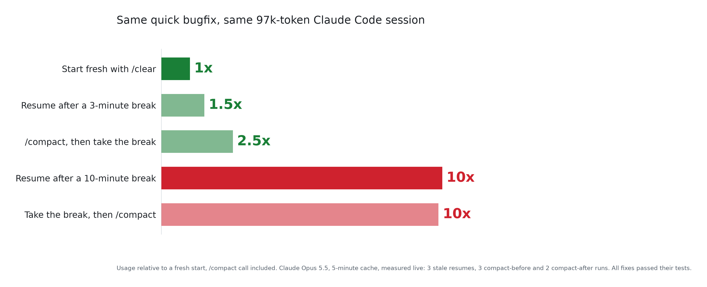
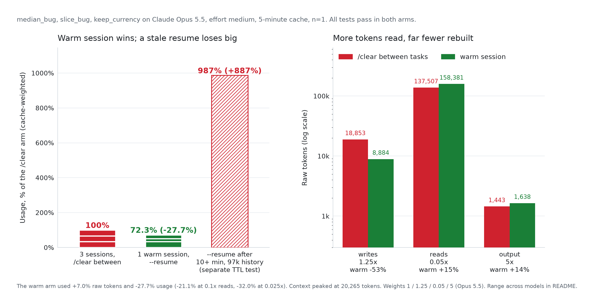
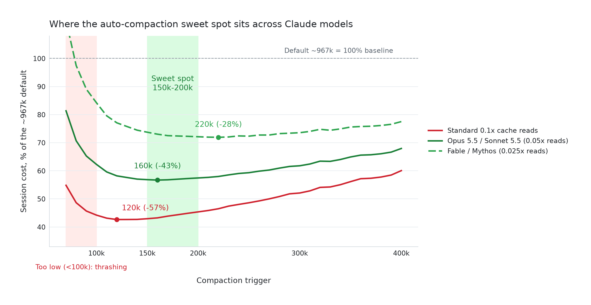

# Claude Code usage: best practices and anti-patterns

<p align="center"></p>

**Leave a big Claude Code session for 10 minutes, then come back and continue it.** Your next small fix uses about 10 times as much usage as the same fix in a new session. "Usage" means tokens counted the way Anthropic charges for them: re-reading saved history is cheap, sending it again is expensive. During the break, your history left Claude's 5-minute [prompt cache](https://code.claude.com/docs/en/prompt-caching). That cache is a short-lived copy of the conversation, so Claude can reuse it cheaply. Once it is gone, Claude has to process the whole history again. We measured this on real Claude Opus 5.5 runs.



## Best practices

- **Before a break, run [`/compact`](https://code.claude.com/docs/en/commands).** It replaces the chat history with a short summary. The next fix used 2.5x. Without it, it used about 10x. (3 runs) [(details)](#compact-before-or-after-the-break)
- **After a break, start a new session.** Run [`/clear`](https://code.claude.com/docs/en/commands) and write 3 lines: the goal, what is done, what is next. Running `/compact` after the break does not help: it still used about 10x. (3 runs, 2 for `/compact`) [(details)](#1-the-coffee-break-tax)
- **For several small related fixes in a row, keep the same session.** It used 28% less than running `/clear` between fixes. (1 run, small history only) [(details)](#3-clear-vs-a-warm-session)
- **For scheduled `claude -p` jobs, start a new session each run.** Keep notes in a file. Continuing the last session with `--resume` costs about 3x. (estimate) Not tested live. [(details)](#1-the-coffee-break-tax)
- **Keep tool output short.** Long output stays in the chat and is sent again on every later turn. A failing test log of about 750 tokens made that turn and the next 5 use 15% more than a 1-line summary. A log of about 5,000 tokens made them use 64% more. (2 runs each) [(details)](#7-long-tool-output)
- **Do not turn off a tool or switch models in the middle of a task.** Turning off one tool made the next turn use 22x a normal turn, because the whole chat was processed again. Anthropic's docs say switching models does the same. We did not test that. (2 runs) [(details)](#8-switching-models-or-effort)
- **Use the Claude Code CLI.** It used the least of the three tools we tested. T3 Code used 1.19x the CLI. The Desktop Code tab used at least 1.80x. Its first request was about twice as large (39,749 vs 19,528 tokens). We did not test the Claude chat app. (1 run) [(details)](#4-three-clients-one-bugfix)
- **Raw token counts are misleading.** Two runs with the same raw tokens (about 294,000) differed 6.5x in usage, because cached tokens cost far less. [(details)](#the-evidence)

## Check your own habits: paste this into Claude Code

Everyone uses Claude Code differently. The best settings for you depend on your own logs. Paste the text below into Claude Code to check your habits once:

```text
Everyone uses Claude Code differently. Recommend settings that fit MY logs, not general advice.

1. Clone https://github.com/inevolin/claude-code-usage-analysis into a temp folder, then run:
   python3 -m pip install -e .
   OUT=$(mktemp -d)
   python3 -m cc_usage_study.analyze ~/.claude/projects --summary --sessions --calls -o "$OUT/report.json"
   Keep that report file outside any git repo. Use only that file: summary numbers, timestamps, token counts, entrypoints, and compact_boundary fields. Do not read, paste, or upload the raw text of my chats. Do not report money amounts. Use % and multipliers.

2. Score my habits with my own numbers:
   - Continuing a session after the cache expired: use cache_rebuilds_main.ttl_expired_rebuild (a gap over 5 minutes if cache_creation_5m_tokens are most of the writes, or over 1 hour if cache_creation_1h_tokens are).
   - /compact after a break, or before: compare boundary_rows timestamps and trigger with gaps in call_rows.
   - Many short sessions close together (a rough sign of /clear between related work) instead of one continued session.
   - sdk-cli (claude -p) sessions continued across gaps, instead of a new session each run.
   - Which app I used, from by_entrypoint: cli = Claude Code CLI, sdk-cli = claude -p, t3-code = T3 Code, claude-desktop-3p = Desktop Code tab. Prefer the CLI, or T3 Code. Desktop's Code tab used at least 1.80 times the CLI in this study. The Claude chat app was not measured.
   - Sessions where one request reaches 300,000 tokens: use one call's prompt_tokens or compact pre_tokens. Do not use the session-sum of prompt_tokens.

3. Write a short report:
   (a) the 3 habits costing me the most, with my % or multipliers;
   (b) changes that fit my pattern, only from this list: /compact before breaks, /clear plus a 3-line reminder when I am already back, a new `claude -p` session each scheduled run, prefer the CLI or T3 Code over Desktop's Code tab. Mention `--autocompact` only as an unproven idea, and only if my sessions actually get that large;
   (c) what you could not tell. If a field is missing, compute it from timestamps and compact_boundary metadata only, or say you cannot tell.
```

This runs on your computer, on the files in `~/.claude/projects`. The prompt tells Claude to use summary numbers and timestamps, not the raw text of your chats. The only thing that leaves your machine is the normal Claude Code conversation. That conversation will include those summary numbers.

Or install the skill, then type `/claude-code-usage-check` in a new session:

```bash
mkdir -p ~/.claude/skills
cp -R skills/claude-code-usage-check ~/.claude/skills/
```

To run only the analyzer yourself: `python3 -m cc_usage_study.analyze ~/.claude/projects --summary --sessions --calls -o ./local-out/report.json`. Keep the report file outside git. The tool never copies the text of your prompts.

## Myths and unknowns

- Our calculation says `--autocompact 180000` uses about 43% less. In a live test on a 270,000-token session, it only tied the default. We ran that test once, with no long pauses. ([details](#6-hypotheses-compaction-settings-and-sweet-spots))
- We do not yet know the best compact settings for very long sessions. Our calculation failed when we checked it against the live tests. ([details](#does-the-model-hold-up))
- Editing `CLAUDE.md`, adding an MCP server, or changing effort between turns did not break the cache. The next turn used about the same as a normal turn (0.95x to 1.08x on average). (3 runs each, Claude Code 2.1.325) ([details](#9-editing-claudemd-or-adding-an-mcp-server))
- Fewer raw tokens is not the same as less usage. One setting sent 63% fewer raw tokens than the default, and used 25.2% more. ([details](#2-compaction-measured-live))

A "break" means you were away longer than the [prompt cache](https://code.claude.com/docs/en/prompt-caching). That cache lasts **5 minutes** if you use an API key or usage credits, and **1 hour** if you use a subscription within its [usage limits](https://support.claude.com/en/articles/11145838-use-claude-code-with-your-pro-max-or-ultra-plan). We measured 10 to 13 minute breaks on the 5-minute cache. ([does this apply to you?](#does-this-apply-to-you))

## Copy-paste

```bash
# Cron and CI: start a new session every run, and keep notes in a file
claude -p "$(cat .agent/handoff.md) Continue the nightly triage." --output-format json
```

```text
# Before a break
/compact Keep: the open issue, files touched, test command

# Back after a break, new task
/clear
Goal: fix the currency rounding in invoices.
Done: tests in tests/test_invoice.py reproduce it.
Next: patch money.py, run the suite.
```

**Contents:** [best practices](#best-practices) · [check your habits](#check-your-own-habits-paste-this-into-claude-code) · [the evidence](#the-evidence) · [the coffee-break test](#1-the-coffee-break-tax) · [`/compact`](#compact-before-or-after-the-break) · [does this apply to you](#does-this-apply-to-you) · [does the model hold up](#does-the-model-hold-up) · [compaction](#2-compaction-measured-live) · [`/clear`](#3-clear-vs-a-warm-session) · [clients](#4-three-clients-one-bugfix) · [tool output](#7-long-tool-output) · [models and effort](#8-switching-models-or-effort) · [`CLAUDE.md` and MCP](#9-editing-claudemd-or-adding-an-mcp-server) · [hypotheses](#6-hypotheses-compaction-settings-and-sweet-spots) · [limits](#honest-limits) · [reproduce](#reproduce)

---

## The evidence

This is the data behind the rules above. You do not need to read it to use the rules.

| Finding | Setup | Evidence |
| --- | --- | --- |
| Continuing after 10+ minutes used about 10 times as much as a new session. Continuing after 3 minutes, with 97,000 tokens of history, used 1.5 times as much. | Opus 5.5, 5-minute cache, 97,000 tokens of history, breaks of 3.3 and 10 to 13 minutes, 3 small fixes | Tested live, `ttl_runs`: 3 continue-and-fresh pairs, 1 warm continue |
| `/compact` before a break used 2.5 times as much as a new session. After a break it used about 10 times as much. | Same sessions and fixes | Tested live, `compact_runs`: 3 before, 2 after |
| A continued session used 27.7% less than `/clear` | Same 3 fixes, history under 21,000 tokens | Tested live, `clear_vs_warm`, n=1 |
| Hidden summary usage was 11.8% to 25.5%. Lower compact triggers tied or lost on a session of about 270,000 tokens. | 24-module migration over 4 phases, about 270,000 tokens at peak, no long pauses | Tested live, `compaction`, n=1 per setting, 5 settings; two settings fail the 15% gate |
| T3 Code used 1.19 times the CLI. Desktop's Code tab used at least 1.80 times the CLI. | Identical 3-line `CLAUDE.md`, no user MCP servers | Tested live, `client_comparison`, n=1 per client |
| A 750-token test log made that turn and the next 5 use 1.15 times as much as a 1-line summary. A 5,000-token log: 1.64 times. | Opus 5.5, warm cache, about 17,000 tokens of context, 1 test run then 5 short questions | Tested live, `tool_output_runs`: 2 runs per arm, 3 arms |
| Turning off one tool between turns made the next turn use 22 times a normal turn. Changing effort, editing `CLAUDE.md`, or adding an MCP server did not break the cache. | Opus 5.5, warm cache, about 44,000 tokens of context, one change per turn | Tested live, `mid_session_runs`: 3 sessions, 2 for the tool change. Model switch: docs only |
| The compact trigger formula, and when idle compact runs | Claude Code v2.1.325 binary | Read from the binary. Live `preTokens` went 0.3% to 55.5% past the formula |
| Pause curves, cron jobs, the 1-hour cache, and compact settings for long sessions | Caching simulator | Estimate, `outputs/summary.json`. The short-task cache math was checked against live runs. The long-session compact calculation failed that check |

That is 14 live runs across the compact, `/clear`, and client tests, plus a 9-run cache-expiry test, a 5-run `/compact` test, a 6-session tool-output test, and a 3-session test of changes between turns. Everything is in `outputs/live_experiments.json` (numbers only, no prompts or paths). Estimated numbers come from the caching simulator in `src/cc_usage_study/` and are in `outputs/summary.json`. You can check all of this without making live API calls.

> **Units.** "Usage" is **cache-weighted usage**: tokens counted the way the API charges for them. On Opus 5.5 the weights are `1 / 1.25 / 2 / 0.05 / 5` (new input / 5-minute cache write / 1-hour cache write / cache read / output). Raw token counts can mislead. Below, one continue after 3 minutes and one after 10 minutes both moved the same 294,000 tokens, but usage differed by 6.5 times.

### 1. The coffee-break tax

This section shows what happens when you leave a large session and come back.

Claude Code [saves a copy of the conversation start](https://code.claude.com/docs/en/prompt-caching) ([API caching docs](https://platform.claude.com/docs/en/build-with-claude/prompt-caching)). If you continue inside the cache time limit, Claude re-reads the history at the cheap read weight. After that time limit, every old token is **written to the cache again** at the full write weight.

We built a session to about 97,000 tokens, walked away, and continued it for a small bugfix. Each time we also ran the same fix in a brand-new session. We used three different fixes. All of them passed their tests.

| Same small fix | New session (`/clear`) | Continued after 3.3 min | Continued after 10 to 13 min |
| --- | ---: | ---: | ---: |
| Usage, new session = 1 | **1** | **1.5x** | **9.8x to 9.9x** (3 of 3) |
| Across models' read weights | 1 | 1.0x to 2.3x | 9.0x to 10.5x |
| First call: tokens written to cache | about 5,500 | 743 | 86,178 to 88,229 |
| Raw tokens for the whole fix | about 52,000 | 293,834 | 294,158 to 301,452 |

- Even when the cache was still warm, 97,000 tokens of history was too much to bring into a small, unrelated fix. Our calculation says a warm continue only pays off while history is under about 24,000 tokens.
- The 10 times figure is compared with a small fix. A bigger next task would shrink that ratio, because the new session's own work would count for more. The extra cost for each old token you carry (about 1.4 units) does not shrink.

#### `/compact` before or after the break

This section shows that shrinking history helps only if you do it before you walk away.

In a script it is `claude -p "/compact Keep: the 3 issues found, files touched, test command" --resume SESSION`. The log then gets a `compact_boundary` with `trigger: manual`.

| Same small fix, new `/clear` session = 1 | `/compact` call | Next fix | Total |
| --- | ---: | ---: | ---: |
| `/compact` right away (cache still warm), then a 6.5 to 11 min break, tested 3 times | 1.1 to 1.2 | 1.3 | **2.5x** (2.49 to 2.53, each compared with its paired new session) |
| Break first (cache already gone), then `/compact`, tested 2 times | 8.0 to 8.8 | 1.2 to 1.5 | **9.3x and 10.2x** (paired) |
| Just continue after the break | none | 9.8 to 9.9 | **9.8x to 9.9x** |

- **Before the break it is cheap:** the summary call re-reads the 96,000-token history from the warm cache.
- **After the break it does not help the next fix:** the summary call sends the whole cold history again, as 87,000 to 90,000 tokens of new input. It only helps on later turns.
- The compact call does not show up in the log as an assistant row. Its tokens come from Claude Code's `cost_state`.


Scheduled jobs are the worst case in our calculation: twelve `claude -p` runs spaced past the cache time limit, where every `--resume` rebuilds the whole growing history from scratch. New sessions use 33% of that on the 1-hour cache, and 35% on the 5-minute cache.

A stale continue costs more than a new start once history passes **about 10,000 tokens**, even if the new session needs 2 extra exploration calls (estimate; 8,300 on the 1-hour cache; 10,800 and 8,700 with the measured task shape). Our calculation says a warm continue still wins if history size times the number of remaining calls stays under about 120,000 at the 0.05 read weight (about 57,000 at the 0.1 read weight). The diamonds are the live runs. The curve's percentages use the original numbers, which understate the penalty above about 30,000 tokens. See the check below.

### Does this apply to you?

This section shows how the 10 times figure changes with your cache time limit and your model.

The 10 times figure depends on how long your [prompt cache](https://code.claude.com/docs/en/prompt-caching) lasts, and on how cheap cache reads are on your model.

| Your setup | Cache time limit | What a "break" is | What to expect |
| --- | --- | --- | --- |
| API key or usage credits | 5 minutes | Anything over 5 minutes | The measured 10 times (breaks of 10 to 13 minutes; a break just past 5 minutes was not measured) |
| Subscription within its [usage limits](https://support.claude.com/en/articles/11145838-use-claude-code-with-your-pro-max-or-ultra-plan) | 1 hour | Over an hour | No jump for short breaks. After an hour, carried history is rewritten at 2 times the input price, not 1.25 times: about 11 times for the same fix (estimate, 10.98 times with the adjusted task shape; not measured) |
| Model with 0.1x reads (Sonnet 5, Opus 4.7) | 5 minutes | Over 5 minutes | Stale continue 9.0 times a new session (the same runs, reweighted) |
| Model with 0.025x reads (Fable, Mythos) | 5 minutes | Over 5 minutes | Stale continue 10.4 times a new session (the same runs, reweighted) |

A subscription's five-hour and weekly meter uses weights Anthropic does not publish. So it can rank two habits differently from the list-price units used here.

### Does the model hold up?

This section checks our calculations against the live tests.

The estimated rules (scheduled jobs, pause traps, long-session compact settings) come from the simulator. `python -m cc_usage_study.validate` scores it against every live run, with no API calls, in two versions. The **original** numbers are the ones used in this README. The **adjusted** version learns the task shape (calls per task, tokens per call, and the starting instructions already saved from earlier sessions) from the 3 new `/clear` sessions only.

Each run has a role. The new sessions are used to tune the adjusted calculation. The warm and stale continues are held-out checks: the adjusted calculation sees only the new sessions and the history size. The `/compact` runs are not held-out checks. They use each run's own summary size and post-compact prompt.


| Same small fix, mean new session = 1 | How we used this run | Measured | Original calculation | Adjusted calculation |
| --- | --- | ---: | ---: | ---: |
| Warm continue | held-out check | 1.51 | 1.07 | 1.47 |
| Stale continue | held-out check | 9.87 | 3.53 | 9.80 |
| `/compact` before the break | uses this run's own summary size | 2.49 | 1.84 | 2.40 |
| `/compact` after the break | uses this run's own summary size | 9.64 | 3.96 | 10.53 |

- **The cache math matches the continues.** All 4 continue runs land within 3% with the adjusted shape. With the original numbers, none of the 4 were close (all were off by more than a quarter). This is still a weak test: 4 runs from one 97,000-token session. A stale continue is mostly one rewrite of the cold history, which any sound cache model gets right.
- **The original task shape is the problem.** The original numbers put a new session at 4.5 times the measured cost. Most of that is the task shape: 5 calls with 2,000-token tails and 600 output tokens each, where the live fix took 3 calls with far smaller turns (fixing that alone leaves 2.1 times). The starting instructions already saved from earlier sessions (about 11,400 tokens) are the smaller part (fixing that alone leaves 3.4 times).
- **What that changes (estimate; only 97,000 tokens was measured).** The break-even point barely moves, but estimated continue penalties above it look too low. At 30,000 tokens of history, a stale continue costs +96% compared with `/clear` plus 2 exploration calls, not the original +41%. At 60,000 tokens, it is +245%, not +102%. The break-even history barely moves (10,100 to 10,800 on the 5-minute cache, 8,300 to 8,700 on the 1-hour cache).
- **`/compact` after a break** sent the cold history as plain input (1 times), not as a cache write (1.25 times), which is what the simulator assumes. That was read from these same runs.
- **The long-session compact calculation fails when checked against the live tests.** We replayed the migration task from the default setting's measured path. The calculation gets the direction right on 2 of 4 trigger settings, and lands within 5 points on 1. It predicts -0.9% for `--autocompact 140000`, where the live run measured +18.1%. It predicts +51.7% with 14 compacts for the stacked setting, where the live run measured +13.6% with 6. It prices a summary call at 21,600 units, against a measured 36,600 per compact. Real context growth is uneven (1 to 14 calls between compacts in one setting), so even growth places compacts in the wrong spots. Fitting summary size and extra calls on the same settings made it worse. Treat the settings section below as an idea to test, not as a result.

Full scores per run: `outputs/validation.json`.

### 2. Compaction, measured live

This section shows that shrinking history mid-session is not always cheaper, and that some of the usage is hidden.


Every setting ran the same task: a 24-module migration over 4 `--resume` phases. Opus 5.5, effort medium, 5-minute cache, no long pauses, n=1 per setting. Green is what the log shows. Red is summary traffic that only appears in Claude Code's own `cost_state` total.

- **Fewer tokens is not less usage.** The 100,000 setting sent 63% fewer raw tokens (2.27 million compared with 6.12 million) and used 25.2% more. Most of the default's tokens were cheap cache reads.
- **Part of the usage is invisible.** Summary calls were 11.8% to 25.5% of each compacting setting, about 36,600 units per compact on average.
- **The ranking depends on the read weight.** At 0.1x reads, the 180,000 setting comes out 13.6% under the default. The tie also assumes no pauses. One pause past the cache, at about 260,000 tokens of history, would add roughly 39% to the default setting (estimate).
- Quality held everywhere: all 5 settings passed the tests and the functional checker, and reported 12 of 12 planted anomalies.

<details>
<summary>Per-setting table</summary>

| Setting | Fires at | Compacts | Usage, default = 100 | Hidden share | Raw tokens compared with default | At 0.1x reads | At 0.025x reads | 15% `preTokens` gate |
| --- | ---: | ---: | ---: | ---: | ---: | ---: | ---: | --- |
| Default 1M | 967,000 | 0 | **100** | 0% | 6.12M tokens | 100 | 100 | no fire |
| `--autocompact 180000` | 147,000 | 2 | **100 (tie, +0.1%)** | 11.8% | -48% | -13.6% | +11.6% | fails (+15.7%) |
| 250,000 window + override 25 | 57,500 | 6 | **+13.6%** | 24.3% | -70% | -10.2% | +33.5% | fails (+55.5%) |
| `--autocompact 140000` | 107,000 | 4 | **+18.1%** | 13.9% | -42% | +1.0% | +32.5% | passes |
| `--autocompact 100000` | 67,000 | 7 | **+25.2%** | 25.5% | -63% | +0.1% | +46.2% | passes |

The order is not a smooth line at n=1 (57,500 beat 107,000 and 67,000). So "a lower trigger pays past a break-even length" is a claim from the calculation, not from this table.

</details>

### 3. `/clear` vs a warm session

This section shows that for a few quick, related fixes, staying in the session used less than starting over each time.



Three quick fixes, one after another, n=1. Three new sessions compared with one session continued inside the cache time limit. The continued session read 7.0% more raw tokens but rebuilt 53% fewer, so it used **27.7% less** (21.1% to 32.0% by model). Context peaked at 20,265 tokens. This only holds while history is small.

### 4. Three clients, one bugfix

This section compares the same fix in the Claude Code CLI, T3 Code, and Claude Desktop's Code tab.


Same Opus 5.5, effort medium, identical 3-line `CLAUDE.md`, no user MCP servers, n=1 per client. All three fixed all 3 planted bugs.

| | CLI interactive | T3 Code | Desktop Code tab |
| --- | ---: | ---: | ---: |
| First request, tokens | 19,528 | 22,842 | 39,749 |
| Inline / deferred tools | 14 / 15 | 15 / 82 | 35 / 82 |
| Fix usage compared with the CLI | 1.00x | **1.19x** (1.17x to 1.20x by model) | **1.80x** (1.71x to 1.92x by model) |

T3 Code runs Claude Code through the Agent SDK and adds 67 deferred tools plus a longer system prompt. Desktop's Code tab carries a whole app (35 inline tools, 3.5 times the system prompt) and writes no `cost_state` row, so its number is at least 1.80 times the CLI. We did not measure the Claude chat app. Full table: `benchmarks/client_comparison.md`.

### 5. Where compaction actually fires

This section shows that the number you type is not the point where compact actually runs.

Read from the Claude Code v2.1.325 binary. The number you type is not where it fires: **subtract 33,000, and never stack two knobs.** The first live compact fired 0.3% to 55.5% past the formula's threshold. The check runs between requests, and one large tool result can carry the context well past it.

```text
effective_window = window - min(maxOutputTokens, 20000)
threshold        = effective_window - 13000                                    # no override
threshold        = min(floor(effective_window * pct / 100), effective_window - 13000)   # with CLAUDE_AUTOCOMPACT_PCT_OVERRIDE
```

| You set | It fires at |
| --- | ---: |
| nothing, 1M window | 967,000 |
| nothing, 200k model | 167,000 |
| `--autocompact 180000` | 147,000 |
| `CLAUDE_AUTOCOMPACT_PCT_OVERRIDE=18`, 1M window | 176,400 |
| `--autocompact 100000` | 67,000 |
| 250,000-token window and `CLAUDE_AUTOCOMPACT_PCT_OVERRIDE=25` | 57,500 |

**Idle compact** summarizes a big session at about 90% of the cache time limit, before the cache expires. It only runs when all of these hold: `idleCompaction` is on (default since v2.1.299), the session is on the **1-hour** cache (never on API keys), the **process is still alive** (not a sleeping laptop or a finished `claude -p`), and context is at least `CLAUDE_CODE_IDLE_COMPACT_MIN_TOKENS` (**200,000** by default, 100,000 at the lowest). `--autocompact 180000` keeps you under 200,000, so pair it with `CLAUDE_CODE_IDLE_COMPACT_MIN_TOKENS=100000` if you take long breaks with the terminal open.

### 6. Hypotheses: compaction settings and sweet spots

This section is a set of ideas to test, not a result. The compact calculation failed when we checked it against the live tests (see [the check above](#does-the-model-hold-up)), so do not treat these as savings.

The main idea: for a long session headed past 300,000 tokens, `claude --autocompact 180000` is estimated at about 43% less. Live, it tied the default on a 270,000-token session (n=1, no pauses). If you try it and take long breaks with the terminal open, pair it with `CLAUDE_CODE_IDLE_COMPACT_MIN_TOKENS=100000`.


<details>
<summary>Workflow and pause-trap tables (estimate, original numbers)</summary>

| Workflow | Best fire point | You type | Usage compared with that workflow's default |
| --- | ---: | ---: | ---: |
| Deep feature work, 0.1x reads (Sonnet 5, Opus 4.7) | 120k | 153,000 | -57% |
| Deep feature work, Opus 5.5 / Sonnet 5.5 | 160k | 193,000 | -43% |
| Marathon refactor, 150 turns, smaller steps | 130k | 163,000 | -54% |
| Heavy file reads, big working memory | 280k | 313,000 | -24% |
| Rules that live only in the chat, 8 repairs per compact | 360k | 393,000 | -24.9% |
| Workday with long breaks, idle compact ran | 140k | 173,000 | -18% |
| Quick bugfix | no trigger is reached | leave it | 0%, or +8% if forced to fire at 100k |
| 200k-context model | leave the 167,000 default | leave it | +239% with override 25 (fires at 45,000 and thrashes) |

| Trap | Compared with | Usage |
| --- | --- | ---: |
| Lunch breaks, laptop slept, idle compact did not run | the same day with idle compact running | +76% |
| API key, 7-minute gaps past the 5-minute cache | the same session answered within 2 minutes | +213% |
| Stale `--resume` with 60,000 tokens of history | `/clear` plus a handoff, 2 extra exploration calls | +102% (+245% adjusted) |
| Hourly `claude -p` with `--resume` | a new session every run | +201% |

</details>




### 7. Long tool output

This section shows what a long test log costs after Claude has read it.


A new session runs a failing test suite once and reports the result in one line. Then it answers 5 short questions with no tools, a few seconds apart, so the cache stays warm. Only the test output changes: a 1-line summary (48 tokens), a normal failing pytest log (803 tokens), or a long log with tracebacks and captured logs (8,602 tokens). Claude Code cut the long log to about 10,000 characters before it went into the chat. Opus 5.5, n=2 per arm, about 17,000 tokens of context. Every run named the same 3 failing tests.

| Test output | Extra tokens in the chat | That turn | Next 5 turns | All 6 turns |
| --- | ---: | ---: | ---: | ---: |
| 1-line summary | 0 | 1.00x | 1.00x | 1.00x |
| Normal log | 755 | 1.15x | 1.16x | **1.15x** |
| Long log | 5,051 | 1.88x | 1.33x | **1.64 times** |

The log is written to the cache once, then read again on every later turn. Part of the gap in the next 5 turns is longer answers after a long log. Without output tokens the gap is 1.08x and 1.29x. These sessions were small, so the log is a large share of each turn. In a bigger session the share is smaller, but the extra tokens per turn stay the same. After a break the cache expires, and the log is written to the cache again with the rest of the chat.

### 8. Switching models or effort

This section checks whether changing settings between turns throws the cache away.

**Switching models: from Anthropic's docs, not measured.** The [Claude Code docs](https://code.claude.com/docs/en/prompt-caching#switching-models) say each model has its own cache. After `/model`, the next request reads the whole chat with no cache hits. Our live runs use only Opus 5.5, so we did not test it.

**The closest test on Opus 5.5: turning off one tool.** We turned off one built-in tool (`--disallowedTools Edit`) between turns. That changes the tool list at the very start of the prompt, so nothing after it matches the cache. This is the same effect the docs describe for a model switch. The next turn read 0% from the cache, wrote about 43,700 tokens again, and used **22x** a normal turn (21.8x to 22.2x, n=2).

**Changing effort did not break the cache.** Medium to high: 0.98x of a normal turn. High back to medium: 0.95x. 99.7% or more was read from the cache (n=3). The docs say Opus 5.5 keeps the cache when effort changes. On many older models it does not.

Each session read 2 log files (about 44,000 tokens of context), then answered one short question per turn with no tools. Each turn was a new `claude -p --resume` run a few seconds after the last one. One thing changed before each test turn. Control turns changed nothing. Each change is compared with the average of the control turns in the same session.

### 9. Editing `CLAUDE.md` or adding an MCP server

This section checks two changes we expected to break the cache. They did not.

| Change between turns | Next turn compared with a normal turn | Read from cache |
| --- | ---: | ---: |
| No change | 1.00x | 99.1% to 99.9% |
| Change effort, medium to high | 0.98x (0.96x to 1.00x) | 99.7% |
| Edit one line of `CLAUDE.md` | 1.08x (1.00x to 1.19x) | 99.5% |
| Add an MCP server with 1 tool | 0.98x (0.97x to 1.00x) | 99.6% |
| Turn off one built-in tool | **22x** (21.8x to 22.2x) | 0% |

Claude Code 2.1.325 did not change the start of the prompt for either change. It added the new `CLAUDE.md` at the end of the chat as a note that the instructions changed. It listed the new MCP tool at the end as a deferred tool (tool search). So the rest of the chat still matched the cache. An edit to `CLAUDE.md` only reaches Claude after a restart, `/clear`, or `/compact` ([docs](https://code.claude.com/docs/en/prompt-caching#editing-claude-md-mid-session)). We tested the restart case: `--resume` in a new process. The docs say that with tool search turned off, adding an MCP server does break the cache. We did not test that. n=3 per change, one session size, Opus 5.5.

## Honest limits

This section lists what this study cannot claim.

- **Small n.** Most settings were tested once (n=1). The coffee-break and `/compact` tests ran 2 to 3 times. We report ranges, not confidence intervals.
- **Small sessions for the newest tests.** The tool-output and between-turn tests used about 17,000 and 44,000 tokens of context, with a warm cache.
- **One model, small tasks, one cache time limit.** All live runs used Opus 5.5 on the 5-minute cache. 1-hour cache numbers are estimates.
- **Ratios compared with a small fix look larger.** The 10 times figure is compared with a 3-call fix. The extra cost per carried token is the number that still holds for a bigger next task.
- **These units are not your subscription bill.** Units follow API list prices. Subscription limits use weights Anthropic does not publish.
- **The compact calculation failed when checked against the live tests.** See [the check above](#does-the-model-hold-up).
- **The short-task check is narrow.** 4 held-out checks from one session, one history size, and one model. It shows the cache math is right. It does not show that every estimated number is right.
- **Two of the five compact settings fail the repo's own validity check.**

More on method and open questions: [FINDINGS.md](FINDINGS.md).

## Reproduce

These commands rebuild the study on your machine.

```bash
python3 -m pip install -e ".[dev]"
python3 -m cc_usage_study.pipeline        # analyze, check, simulate, figures, validate, verify; one command
python3 -m pytest -q
```

Run the analyzer on your own logs, and keep the output outside git:

```bash
python3 -m cc_usage_study.pipeline --projects ~/.claude/projects --split-date YYYY-MM-DD --out ./local-out
```

The analyzer copies summary numbers only, never prompt text. Read `preTokens` on your first `compact_boundary`. If it does not match the table in section 5, your setting is not the one you think.

<details>
<summary>Setup and what's inside</summary>

- Clients: Claude CLI v2.1.325, T3 Code v0.1.9 (Agent SDK wrapping Claude Code v2.1.325), Claude Desktop v5.1231.2 (Code tab, bundled Claude Code v2.1.321).
- Model `claude-opus-5-5`, effort `medium`, 1M context, `maxOutputTokens` 128,000.
- Cache-weighted units are the logged list-price cost divided by the Opus 5.5 input price. Pricing snapshot 13 November 2026, [pricing page](https://platform.claude.com/docs/en/about-claude/pricing).
- "Hidden" usage is `cost_state.totalCostUSD` minus the deduplicated assistant rows in the same transcript.

| | |
| --- | --- |
| `outputs/live_experiments.json` | All live runs, sanitized |
| `outputs/summary.json` | Every estimated number |
| `outputs/validation.json` | The calculation scored against every live run |
| `src/cc_usage_study/` | Extractor, caching model, simulator, validation, charts |
| `benchmarks/protocol.md` | How the live runs were set up, and the validity gate |
| `benchmarks/client_comparison.md` | The full client table |
| `docs/reference.md` | Knobs, model windows, caching, the traps |
| `docs/examples.md` | The arithmetic behind a single session |
| `docs/article-draft.md` | The long-form essay |

</details>

### Anthropic docs

- [Prompt caching in Claude Code](https://code.claude.com/docs/en/prompt-caching): which requests get the 5-minute or 1-hour cache, and how to choose it
- [Prompt caching on the API](https://platform.claude.com/docs/en/build-with-claude/prompt-caching): cache lifetime, 1-hour cache, write and read multipliers ([pricing](https://platform.claude.com/docs/en/about-claude/pricing))
- [Manage costs in Claude Code](https://code.claude.com/docs/en/costs) and [context window](https://code.claude.com/docs/en/context-window)
- [Commands](https://code.claude.com/docs/en/commands): `/compact`, `/clear`, `/usage`
- [Claude Code with a Pro, Max or Ultra plan](https://support.claude.com/en/articles/11145838-use-claude-code-with-your-pro-max-or-ultra-plan) (five-hour and weekly limits) and [usage limit best practices](https://support.claude.com/en/articles/9797557-usage-limit-best-practices)
- [API rate limits](https://platform.claude.com/docs/en/api/rate-limits)

## Credits

Co-produced by Grok 4.7 and Claude Fable 5.2: AI-assisted research and writing, with Fable 5.2 reviewing and critiquing the analysis. Live experiments ran on Claude Opus 5.5.

## License

MIT. See `LICENSE`.
