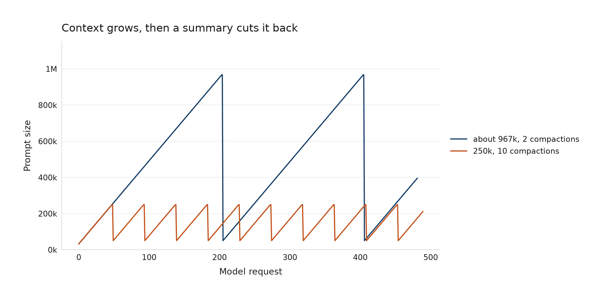

# Claude Code compaction study

Compacting earlier can make a long coding session cheaper. It does not, by itself, cut usage by 4x, and "another 200%" is not a real reduction.

## At a glance

- The LinkedIn claim was a personal observation: auto-compaction at 25% "cut usage by almost 4x." A later line said switching to T3 Code cut usage by "another 200%." A reduction cannot exceed 100%. This repo does not replace that with 2x or 3x.
- On a simulated 60-turn session with physical prefix caching, the about-967k trigger costs about **2.1x** as much at API prices as 250k (28.0M vs 13.6M units) and sends about **3.1x** the raw prompt tokens (222.2M vs 72.9M).
- The priced sweet spot is about **150k to 200k** tokens for current Opus and Sonnet read prices, not a blind 25% of a 1M window. At a standard 0.1x read the valley is nearer 120k.
- Two traps: setting a 250k window **and** 25% fires at **62.5k** and can cost more than 25% alone, and a short fix or a burst of repair work can wipe the saving out.
- Local transcripts and live Claude runs are **not in this repo yet**. Every chart is a model under named assumptions. The five-hour meter has no published formula.

A user turn is one message you send. A model request is one API call inside that turn, including a tool batch. The baseline is 60 turns of 8 requests: 4,000 new tokens and 600 tokens of output each, with a warm cache. A warm request reads the previous prompt and writes only the new tail. It does not re-bill the whole history.

## What 2.1x means

Three different things get called "usage." This repo keeps them apart.

| Quantity | Baseline result | What it is |
| --- | --- | --- |
| Raw prompt tokens | 3.05x | How much input the requests carry, including cached input |
| API-equivalent cost | 2.06x | Those buckets at published cache prices (reads at 0.1x) |
| Five-hour and weekly meter | unknown | No published formula. Not estimated here. |

At the cheaper read prices on current Opus 5.5 and Sonnet 5.5 (0.05x), the same session's priced gap falls to 1.69x. The raw-prompt gap stays 3.05x. If reads were free, compacting earlier would not help.

The formula behind the valley is `T* ≈ R + sqrt(2 * K * (g + o) / r)`. R is what remains after a summary. Cheaper reads push the bottom to the right. Closed-form estimates: 126k at 0.1x, 159k at 0.05x, 205k at 0.025x. The grid in the chart bottoms at 120k, 160k, and 220k.

## The picture


The cheap trigger is the bottom of the curve. Dots mark about 120k, 160k, and 220k. 250k, which is 25% of 1M, sits past those bottoms.


Above 1, the higher trigger costs more, so compacting earlier helps. Below 1, it costs more. The short bugfix and the 62.5k compound are the cases that look good in a token graph and lose on price.



One long session. The 250k line is cut back ten times. The 967k line is cut back twice, and it carries a much larger history in between.

## Scenarios

"Times" is the higher trigger divided by the lower one. Above 1, the higher trigger costs more.

| What happened | API | Raw prompt | In one line |
| --- | ---: | ---: | --- |
| Long session, 250k vs about 967k | 2.06x | 3.05x | The baseline. Not 4x. |
| Same session, T3's about-217k reading | 2.15x | 3.39x | A little earlier, a little cheaper. |
| Short bugfix | 1.00x | 1.00x | Neither trigger fires. |
| That bugfix forced to 100k | 0.93x | 1.35x | Fewer tokens, higher priced cost. |
| 15 repair requests per compaction | 1.03x | 1.64x | Lost context eats the API gap. |
| Long breaks, idle compaction on | 1.31x | 1.77x | The default idle path shrinks the gap. |
| 250k window and 25% together (62.5k) | 1.43x | 6.21x | Raw tokens look spectacular. |
| That 62.5k arm versus 250k alone | 0.70x | 2.04x | Compounding costs more at API prices. |

Exact integers are in `outputs/summary.json`. Worked steps are in `docs/examples.md`.

## One knob, not two

Use one control. If both are set, 250,000 and 25% become 62,500.

```bash
# 25% of the window this version already uses. This cannot delay compaction.
CLAUDE_AUTOCOMPACT_PCT_OVERRIDE=25 claude

# Or an absolute window, after the percentage override is unset.
claude --autocompact 250000
```

In T3 Code the control is an "Auto-compact after" number. A source comment says the UI reads that number as about 33,000 tokens short of the boundary. Trust `preTokens` on the compaction event, not the label.

For a finished task, `/clear` drops the conversation. Compaction is for a thread you still need.

## Quick start

Python 3.11 or newer. The analyzer prints aggregates only. It does not copy prompt text.

```bash
python3 -m pip install -e ".[dev]"
python3 -m cc_usage_study.analyze ~/.claude/projects --split-date YYYY-MM-DD --sessions --output outputs/local-report.json
python3 -m cc_usage_study.simulate --out outputs
```

`python3 -m pytest -q` checks the model, the fake transcripts, and that these docs contain no em dashes.

The middle command reads transcripts on your machine. It hashes project paths and does not copy prompts. Replace `YYYY-MM-DD` with the day the setting changed. If that day is more than 30 days ago, the CLI logs from before the change may already have been deleted. Desktop and Cowork transcripts are kept.

Company logs can still contain source code even when the report does not. The safe demo is `fixtures/synthetic/`. Reports from it set `"synthetic": true`.

## Still open

These are measurements, not things the simulator can invent.

- The exact keys that changed: percentage, window, or both. Both at once is the 62.5k trap.
- `claude --version` and the model. The about-967k default moved for Sonnet 5 in v2.1.323.
- Whether the before-week was inside the plan (1-hour cache) or on usage credits (5-minute cache).
- Settings > Usage percentages for the same blocks. The JSONL files do not contain the meter.

Details, links, and the precedence rules are in `docs/reference.md`.

## What's inside

| | |
| --- | --- |
| `docs/reference.md` | The two knobs, precedence, model windows, caching, and the idle-compaction rules |
| `docs/examples.md` | The arithmetic behind the charts, request by request |
| `docs/article-draft.md` | The nevolin.be draft, with empty slots for real logs |
| `outputs/summary.json` | Every scenario, plus the EOQ grid |
| `outputs/figures/` | The charts above, and the rest of the sweep |
| `benchmarks/protocol.md` | How a live comparison should be run, and what it is allowed to claim |
| `benchmarks/client_comparison.md` | Desktop chat, the CLI, and T3 Code, kept separate |
| `fixtures/synthetic/` | Fake transcripts. Reports from them set `"synthetic": true` |

## License

MIT. See `LICENSE`.
