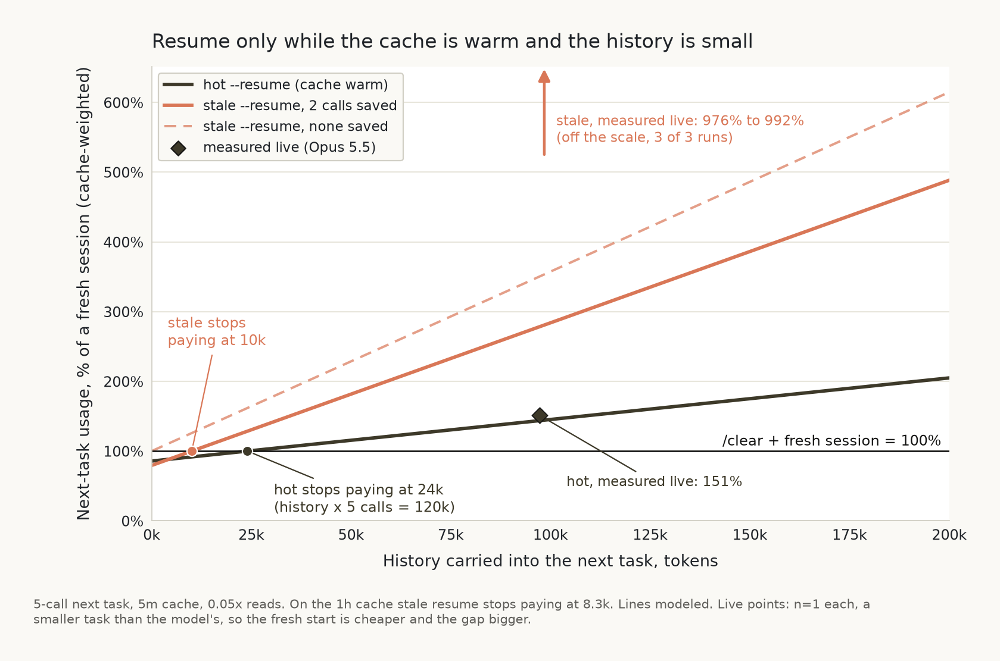
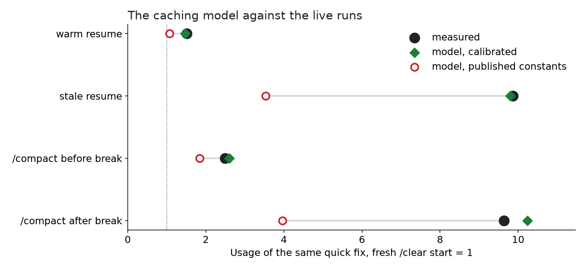
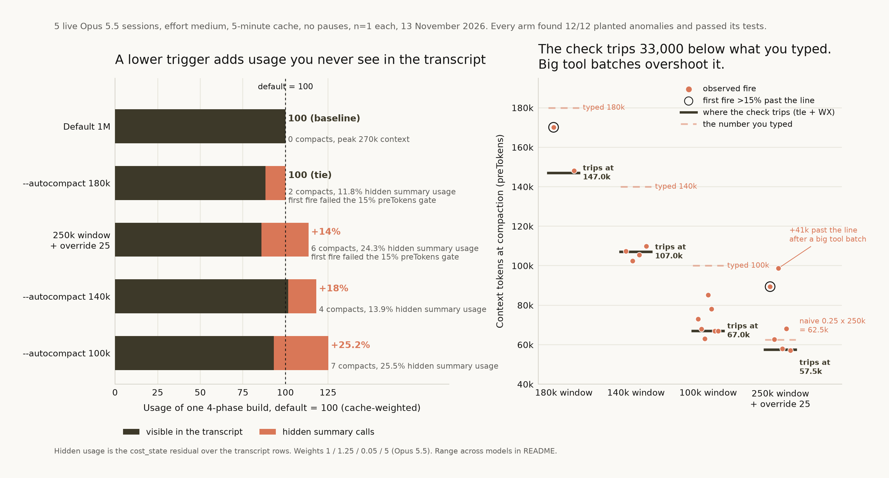

# Claude Code usage: best practices and anti-patterns

**Step away from a big Claude Code session for 10 minutes, come back and resume it, and your next small fix uses about 10 times as much usage as the same fix in a fresh session.** Usage here means tokens weighted the way Anthropic bills them. Your history dropped out of Claude's 5-minute [prompt cache](https://code.claude.com/docs/en/prompt-caching) during the break, so all of it gets processed again at full price. Measured on real Claude Opus 5.5 runs.


## Best practices

- **Leaving for a break?** [`/compact`](https://code.claude.com/docs/en/commands) first (2.5x a fresh session, compact call included), not resume after (about 10x). (n=3) [Why](#compact-before-or-after-the-break)
- **Already back after a break?** [`/clear`](https://code.claude.com/docs/en/commands) and paste a 3-line handoff, not `/compact` after the break (still about 10x). (resume n=3, `/compact` n=2) [Why](#1-the-coffee-break-tax)
- **Quick related fixes back to back?** Stay in the session (28% less), not `/clear` between each. (n=1, small history) [Why](#3-clear-vs-a-warm-session)
- **Scheduled `claude -p` jobs?** Fresh session every run, state in a file, not `--resume` (~3x). (modeled) [Why](#1-the-coffee-break-tax)
- **Write code in the plain Claude Code CLI.** Lowest usage of the three we measured. T3 Code is a reasonable alternative at 1.19x, not Claude Desktop's Code tab at 1.80x (a floor). Desktop sent a much larger first-request prefix (39,749 tokens against the CLI's 19,528). We did not measure the Claude chat app. (n=1) [Why](#4-three-clients-one-bugfix)
- **Judge usage by cache-weighted tokens, not raw counts.** A warm and a stale resume moved the same ~294k raw tokens and differed 6.5x in usage. [Why](#the-evidence)

## Check your own habits: paste this into Claude Code

Everyone uses Claude Code differently, so the settings that help you depend on your own logs. Paste this into Claude Code for a one-off check:

```text
Everyone uses Claude Code differently, so recommend settings that fit MY logs, not generic advice.

1. Clone https://github.com/inevolin/claude-code-usage-analysis into a temp dir, then:
   python3 -m pip install -e .
   OUT=$(mktemp -d)
   python3 -m cc_usage_study.analyze ~/.claude/projects --summary --sessions --calls -o "$OUT/report.json"
   Keep that JSON outside any git repo. Work only from it (aggregates, timestamps, token counts, entrypoints, compact_boundary fields). Never read, paste, or upload raw transcript message text. No dollar amounts; use % and multipliers.

2. Score my habits, using my numbers:
   - Resumes after the cache expired: cache_rebuilds_main.ttl_expired_rebuild (gap > 5 min if cache_creation_5m_tokens dominate, > 1 hour if cache_creation_1h_tokens do).
   - /compact after a break vs before: compare boundary_rows timestamps and trigger with gaps in call_rows.
   - Many short sessions close together (a proxy for /clear between related work) vs one warm session.
   - sdk-cli (claude -p) sessions resumed across gaps vs a fresh session each run.
   - Client mix in by_entrypoint: cli = Claude Code CLI, sdk-cli = claude -p, t3-code = T3 Code, claude-desktop-3p = Desktop Code tab. Prefer the CLI, or T3 Code; Desktop's Code tab was 1.80x in this study (a floor). The Claude chat app was not measured.
   - Sessions whose peak request size reaches 300k: use a single call's prompt_tokens or compact pre_tokens, never the session-sum of prompt_tokens.

3. Short report: (a) the top 3 habits costing me the most, with my % or multipliers; (b) concrete changes that fit my pattern, only from: /compact before breaks, /clear plus a 3-line handoff when I am already back, fresh `claude -p` each scheduled run, prefer the CLI or T3 Code over Desktop's Code tab. Mention `--autocompact` only as an unproven hypothesis, and only if my sessions actually get that large; (c) what you could not tell. If a field is missing, compute it from timestamps and compact_boundary metadata only, or say you cannot tell.
```

This runs locally on `~/.claude/projects`. The prompt tells Claude to work from aggregated numbers and timestamps, not raw message text. Nothing leaves your machine except the normal Claude Code conversation, which will include those aggregates.

Or install the skill and type `/claude-code-usage-check` in a new session:

```bash
mkdir -p ~/.claude/skills
cp -R skills/claude-code-usage-check ~/.claude/skills/
```

To run only the analyzer: `python3 -m cc_usage_study.analyze ~/.claude/projects --summary --sessions --calls -o ./local-out/report.json` (keep the JSON outside git; prompt text is never copied).

## Myths and unknowns

- Lowering the auto-compact trigger (`--autocompact 180000`) is modeled at about 43% less, but it only tied the default live on a 270k session (n=1, no pauses). ([hypotheses](#6-hypotheses-compaction-settings-and-sweet-spots))
- Compaction sweet spots for long sessions are hypotheses: the compaction model failed its [back-test](#does-the-model-hold-up).
- Fewer raw tokens is not less usage. One setting sent 63% fewer raw tokens than the default and used 25.2% more. ([measured](#2-compaction-measured-live))

"Break" means longer than the [prompt cache](https://code.claude.com/docs/en/prompt-caching): **5 minutes** on an API key or usage credits, **1 hour** on a subscription within its [usage limits](https://support.claude.com/en/articles/11145838-use-claude-code-with-your-pro-max-or-ultra-plan). Measured with 10 to 13 minute breaks on the 5-minute cache ([does this apply to you?](#does-this-apply-to-you)).

## Copy-paste

```bash
# Cron and CI: start fresh every run, keep state in a file
claude -p "$(cat .agent/handoff.md) Continue the nightly triage." --output-format json
```

```text
# Before a break
/compact Keep: the open issue, files touched, test command

# Back after a break, new task
/clear
Goal: fix the currency rounding in invoices.
Done: tests in tests/test_invoice.py reproduce it.
Next: patch money.py, run the suite.
```

**Contents:** [best practices](#best-practices) · [check your habits](#check-your-own-habits-paste-this-into-claude-code) · [the evidence](#the-evidence) · [the coffee-break test](#1-the-coffee-break-tax) · [`/compact`](#compact-before-or-after-the-break) · [does this apply to you](#does-this-apply-to-you) · [does the model hold up](#does-the-model-hold-up) · [compaction](#2-compaction-measured-live) · [`/clear`](#3-clear-vs-a-warm-session) · [clients](#4-three-clients-one-bugfix) · [hypotheses](#6-hypotheses-compaction-settings-and-sweet-spots) · [limits](#honest-limits) · [reproduce](#reproduce)

---

## The evidence

| Finding | Setup | Evidence |
| --- | --- | --- |
| Stale resume after 10+ min about 10x a fresh start; warm resume with 97k history 1.5x | Opus 5.5, 5-minute cache, 97k history, breaks of 3.3 and 10 to 13 minutes, 3 small fixes | Measured, `ttl_runs`: 3 stale and fresh pairs, 1 warm |
| `/compact` before a break 2.5x a fresh start, after a break about 10x | Same sessions and fixes | Measured, `compact_runs`: 3 before, 2 after |
| Warm session -27.7% against `/clear` | Same 3 fixes, history under 21k | Measured, `clear_vs_warm`, n=1 |
| Hidden summary usage 11.8% to 25.5%; lower triggers tie or lose on a ~270k session | 24-module migration over 4 phases, about 270k peak, no long pauses | Measured, `compaction`, n=1 per arm, 5 arms; two arms fail the 15% gate |
| Client multipliers 1.19x (T3 Code) and 1.80x (Desktop Code tab, a floor) | Identical 3-line `CLAUDE.md`, no user MCP servers | Measured, `client_comparison`, n=1 per client |
| Trigger formula and idle-compaction conditions | Claude Code v2.1.325 binary | Read from the binary; live `preTokens` overshoot it by 0.3% to 55.5% |
| Pause curves, cron, 1-hour cache, workflow sweet spots | Caching simulator | Modeled, `outputs/summary.json`. Short-task caching back-tested; compaction failed its back-test |

That is 14 live runs across the compaction, `/clear` and client tests, plus a 9-run cache-expiry test and a 5-run `/compact` test. Everything is in `outputs/live_experiments.json` (numbers only, no prompts or paths). Modeled numbers come from the caching simulator in `src/cc_usage_study/` and are in `outputs/summary.json`. No live API calls are needed to check any of it.

> **Units.** "Usage" is **cache-weighted usage**: tokens weighted the way the API bills them, on Opus 5.5 `1 / 1.25 / 2 / 0.05 / 5` (input / 5-minute cache write / 1-hour cache write / cache read / output). Raw token counts mislead: a warm and a stale resume below moved the same 294k tokens and differed 6.5x in usage.

### 1. The coffee-break tax

Claude Code [caches the prompt prefix](https://code.claude.com/docs/en/prompt-caching) ([API caching docs](https://platform.claude.com/docs/en/build-with-claude/prompt-caching)). Inside the cache window a resumed session re-reads its history at the cheap read weight. After the window, every old token is **written to the cache again** at full write weight.

We built a session to about 97k tokens, walked away, and resumed it for a quick bugfix. Each time we also ran the same fix in a brand-new session. Three different fixes, all passed their tests.

| Same quick fix | Fresh (`/clear`) | Resumed after 3.3 min | Resumed after 10 to 13 min |
| --- | ---: | ---: | ---: |
| Usage, fresh = 1 | **1** | **1.5x** | **9.8x to 9.9x** (3 of 3) |
| Across models' read weights | 1 | 1.0x to 2.3x | 9.0x to 10.5x |
| First call: tokens written to cache | about 5,500 | 743 | 86,178 to 88,229 |
| Raw tokens for the whole fix | about 52,000 | 293,834 | 294,158 to 301,452 |

- Even warm, 97k of history was too much to drag into an unrelated small fix. The model says a warm resume only pays while history is under about 24k tokens.
- The multiple is against a small fix. A bigger next task would shrink it, because the fresh session's own work would weigh more. The extra cost per carried token (about 1.4 units) does not shrink.

#### `/compact` before or after the break

Headless it is `claude -p "/compact Keep: the 3 issues found, files touched, test command" --resume SESSION`; the transcript gets a `compact_boundary` with `trigger: manual`.

| Same quick fix, fresh `/clear` = 1 | `/compact` call | Next fix | Total |
| --- | ---: | ---: | ---: |
| `/compact` right away (cache warm), then a 6.5 to 11 min break, n=3 | 1.1 to 1.2 | 1.3 | **2.5x** (2.49 to 2.53, each against its paired fresh run) |
| Break first (cache cold), then `/compact`, n=2 | 8.0 to 8.8 | 1.2 to 1.5 | **9.3x and 10.2x** (paired) |
| Plain resume after the break | none | 9.8 to 9.9 | **9.8x to 9.9x** |

- **Before the break it is cheap:** the summary call reads the 96k history from the warm cache.
- **After the break it saves nothing on the next fix:** the summary call sends the whole cold history again, as 87k to 90k uncached input tokens. It only pays on later turns.
- The compact call is not in the transcript as an assistant row; its tokens come from Claude Code's `cost_state`.





Scheduled jobs are the worst case (modeled): twelve `claude -p` runs spaced past the cache window, where every `--resume` rebuilds the whole growing history cold. Fresh runs use 33% of that on the 1-hour cache and 35% on the 5-minute cache.

A stale resume loses to a fresh start once history passes **about 10k tokens**, even if the fresh session needs 2 extra exploration calls (modeled; 8.3k on the 1-hour cache; 10.8k and 8.7k with the measured task shape). A warm resume wins while history times remaining calls stays under about 120k token-calls at 0.05x reads (about 57k at 0.1x). The diamonds are the live runs. The curve's percentages use the published constants, which understate the penalty above about 30k; see below.

### Does this apply to you?

The 10x depends on how long your [prompt cache](https://code.claude.com/docs/en/prompt-caching) lives and how cheap cache reads are on your model.

| Your setup | Cache lifetime | What a "break" is | What to expect |
| --- | --- | --- | --- |
| API key or usage credits | 5 minutes | Anything over 5 minutes | The measured 10x (breaks of 10 to 13 minutes; a break just past 5 minutes was not measured) |
| Subscription within its [usage limits](https://support.claude.com/en/articles/11145838-use-claude-code-with-your-pro-max-or-ultra-plan) | 1 hour | Over an hour | No cliff for short breaks. After an hour, carried history is rewritten at 2x instead of 1.25x: about 11x for the same fix (modeled, 10.98x with the calibrated task shape; not measured) |
| Model with 0.1x reads (Sonnet 5, Opus 4.7) | 5 minutes | Over 5 minutes | Stale resume 9.0 times (the same runs, reweighted) |
| Model with 0.025x reads (Fable, Mythos) | 5 minutes | Over 5 minutes | Stale resume 10.4 times (the same runs, reweighted) |

A subscription's five-hour and weekly meter uses weights Anthropic does not publish, so it can rank two habits differently from the list-price units used here.

### Does the model hold up?

The modeled rules (scheduled jobs, pause traps, sweet spots) rest on the simulator. `python -m cc_usage_study.validate` scores it against every live run, with no API calls, in two variants: the **published** constants that produced the modeled numbers in this README, and a **calibrated** variant whose task shape (calls per task, tokens per call, the prefix already cached by earlier sessions) is read from the 3 fresh `/clear` runs only.

Each run has a role. The fresh runs are the **fit**. The warm and stale resumes are **predictions**: the calibrated model sees only the fresh runs and the history size. The `/compact` runs are **explained**, not predicted: they use each run's own summary size and post-compact prompt.



| Same quick fix, mean fresh = 1 | Role | Measured | Model, published | Model, calibrated |
| --- | --- | ---: | ---: | ---: |
| Warm resume | prediction | 1.51 | 1.07 | 1.47 |
| Stale resume | prediction | 9.87 | 3.53 | 9.80 |
| `/compact` before the break | explained | 2.49 | 1.84 | 2.40 |
| `/compact` after the break | explained | 9.64 | 3.96 | 10.53 |

- **The caching arithmetic reproduces the resumes.** All 4 resume runs land within 3% with the calibrated shape (published constants: 0 of 4 within a quarter). It is a weak test: 4 runs from one 97k session, and a stale resume is dominated by writing the cold history once, which any sound caching model gets right.
- **The published task shape is the problem.** The published constants put a fresh start at 4.5 times the measured cost. Most of that is the task shape: 5 calls with 2,000-token tails and 600 output tokens each, where the live fix took 3 calls with far smaller turns (fixing that alone leaves 2.1 times). The system prompt already cached by earlier sessions (about 11.4k tokens) is the smaller part (fixing it alone leaves 3.4 times).
- **What that changes (modeled, only 97k was measured).** The break-even barely moves, but modeled resume penalties above it look understated. At 30k of history a stale resume costs +96% against `/clear` plus 2 exploration calls, not the published +41%; at 60k, +245% not +102%. The break-even history barely moves (10.1k to 10.8k on the 5-minute cache, 8.3k to 8.7k on the 1-hour cache).
- **`/compact` after a break** sent the cold history as plain input (1x), not as a cache write (1.25x) as the simulator assumes. That was read from these same runs.
- **Long-session compaction fails its back-test.** Replaying the migration task from the default arm's measured trajectory, the model gets the sign right on 2 of 4 trigger settings and lands within 5 points on 1: it predicts -0.9% for `--autocompact 140000` where the live run measured +18.1%, and +51.7% with 14 compactions for the stacked setting where the live run measured +13.6% with 6. It prices a summary call at 21.6k units against a measured 36.6k per compaction. Real context growth is lumpy (1 to 14 calls between compactions in one arm), so uniform growth misplaces compactions; fitting summary size and extra calls on the same arms made it worse. Treat the sweet-spot section below as a hypothesis.

Full scores per run: `outputs/validation.json`.

### 2. Compaction, measured live



Same task in every arm: a 24-module migration over 4 `--resume` phases. Opus 5.5, effort medium, 5-minute cache, no long pauses, n=1 per arm. Green is what the transcript shows; red is summary traffic that only appears in Claude Code's own `cost_state` total.

- **Fewer tokens is not less usage.** The 100k arm sent 63% fewer raw tokens (2.27M against 6.12M) and used 25.2% more. Most of the default's tokens were cheap cache reads.
- **Part of the cost is invisible.** Summary calls were 11.8% to 25.5% of each compacting arm, about 36.6k units per compaction on average.
- **The ranking depends on read weight.** At 0.1x reads the 180k arm comes out 13.6% under the default. The tie also assumes no pauses: one pause past the cache at about 260k of history would add roughly 39% to the default arm (modeled).
- Quality held everywhere: all 5 arms passed the tests and the functional checker and reported 12 of 12 planted anomalies.

<details>
<summary>Per-arm table</summary>

| Arm | Fires at | Compactions | Usage, default = 100 | Hidden share | Raw tokens vs default | At 0.1x reads | At 0.025x reads | 15% `preTokens` gate |
| --- | ---: | ---: | ---: | ---: | ---: | ---: | ---: | --- |
| Default 1M | 967,000 | 0 | **100** | 0% | 6.12M tokens | 100 | 100 | no fire |
| `--autocompact 180000` | 147,000 | 2 | **100 (tie, +0.1%)** | 11.8% | -48% | -13.6% | +11.6% | fails (+15.7%) |
| 250,000 window + override 25 | 57,500 | 6 | **+13.6%** | 24.3% | -70% | -10.2% | +33.5% | fails (+55.5%) |
| `--autocompact 140000` | 107,000 | 4 | **+18.1%** | 13.9% | -42% | +1.0% | +32.5% | passes |
| `--autocompact 100000` | 67,000 | 7 | **+25.2%** | 25.5% | -63% | +0.1% | +46.2% | passes |

The ordering is not monotonic at n=1 (57,500 beat 107,000 and 67,000), so "a lower trigger pays past a break-even length" is a model claim.

</details>

### 3. `/clear` vs a warm session


Three quick fixes back to back, n=1. Three fresh sessions against one session resumed inside the cache window. The warm session read 7.0% more raw tokens but rebuilt 53% fewer, so it used **27.7% less** (21.1% to 32.0% by model). Context peaked at 20,265 tokens: this only holds while history is small.

### 4. Three clients, one bugfix


Same Opus 5.5, effort medium, identical 3-line `CLAUDE.md`, no user MCP servers, n=1 per client. All three fixed all 3 planted bugs.

| | CLI interactive | T3 Code | Desktop Code tab |
| --- | ---: | ---: | ---: |
| First request, tokens | 19,528 | 22,842 | 39,749 |
| Inline / deferred tools | 14 / 15 | 15 / 82 | 35 / 82 |
| Fix usage vs CLI | 1.00x | **1.19x** (1.17x to 1.20x by model) | **1.80x** (1.71x to 1.92x by model) |

T3 Code runs Claude Code through the Agent SDK and adds 67 deferred tools plus a longer system prompt. Desktop's Code tab carries a whole app (35 inline tools, 3.5 times the system prompt) and writes no `cost_state` row, so its number is a floor. We did not measure the Claude chat app. Full table: `benchmarks/client_comparison.md`.

### 5. Where compaction actually fires

Read from the Claude Code v2.1.325 binary. The number you type is not where it fires: **subtract 33,000, and never stack two knobs.** The first live compaction fired 0.3% to 55.5% past the formula's threshold, because the check runs between requests and one large tool result can carry the context well past it.

```text
effective_window = window - min(maxOutputTokens, 20000)
threshold        = effective_window - 13000                                    # no override
threshold        = min(floor(effective_window * pct / 100), effective_window - 13000)   # with CLAUDE_AUTOCOMPACT_PCT_OVERRIDE
```

| You set | It fires at |
| --- | ---: |
| nothing, 1M window | 967,000 |
| nothing, 200k model | 167,000 |
| `--autocompact 180000` | 147,000 |
| `CLAUDE_AUTOCOMPACT_PCT_OVERRIDE=18`, 1M window | 176,400 |
| `--autocompact 100000` | 67,000 |
| 250,000-token window and `CLAUDE_AUTOCOMPACT_PCT_OVERRIDE=25` | 57,500 |

**Idle compaction** summarizes a big session at about 90% of the cache window, before it expires. It only runs when all of these hold: `idleCompaction` is on (default since v2.1.299), the session is on the **1-hour** cache (never on API keys), the **process is still alive** (not a sleeping laptop or a finished `claude -p`), and context is at least `CLAUDE_CODE_IDLE_COMPACT_MIN_TOKENS` (**200,000** by default, 100,000 at the lowest). `--autocompact 180000` keeps you under 200,000, so pair it with `CLAUDE_CODE_IDLE_COMPACT_MIN_TOKENS=100000` if you take long breaks with the terminal open.

### 6. Hypotheses: compaction settings and sweet spots

The compaction model failed its back-test on size (see [validation](#does-the-model-hold-up)), so read these as hypotheses to test on your own sessions, not as savings.

The main one: for a long session headed past 300k tokens, `claude --autocompact 180000` is modeled at about 43% less. Live, it tied the default on a 270k session (n=1, no pauses). If you try it and take long breaks with the terminal open, pair it with `CLAUDE_CODE_IDLE_COMPACT_MIN_TOKENS=100000`.


<details>
<summary>Workflow and pause-trap tables (modeled, published constants)</summary>

| Workflow | Best fire point | You type | Usage vs that workflow's default |
| --- | ---: | ---: | ---: |
| Deep feature work, 0.1x reads (Sonnet 5, Opus 4.7) | 120k | 153,000 | -57% |
| Deep feature work, Opus 5.5 / Sonnet 5.5 | 160k | 193,000 | -43% |
| Marathon refactor, 150 turns, smaller steps | 130k | 163,000 | -54% |
| Heavy file reads, big working memory | 280k | 313,000 | -24% |
| Rules that live only in the chat, 8 repairs per compact | 360k | 393,000 | -24.9% |
| Workday with long breaks, idle compaction ran | 140k | 173,000 | -18% |
| Quick bugfix | no trigger is reached | leave it | 0%, or +8% if forced to fire at 100k |
| 200k-context model | leave the 167,000 default | leave it | +239% with override 25 (fires at 45,000 and thrashes) |

| Trap | Against | Usage |
| --- | --- | ---: |
| Lunch breaks, laptop slept, idle compaction lapsed | the same day with idle compaction running | +76% |
| API key, 7-minute gaps past the 5-minute cache | the same session answered within 2 minutes | +213% |
| Stale `--resume` with 60k of history | `/clear` plus a handoff, 2 extra exploration calls | +102% (+245% calibrated) |
| Hourly `claude -p` with `--resume` | a fresh session every run | +201% |

</details>


## Honest limits

- **Small n.** Most conditions ran once; the coffee-break and `/compact` tests ran 2 to 3 times. Ranges are reported, not confidence intervals.
- **One model, small tasks, one cache lifetime.** All live runs used Opus 5.5 on the 5-minute cache. 1-hour cache numbers are modeled.
- **Ratios against a small fix inflate.** The 10x is against a 3-call fix; the extra cost per carried token is the portable number.
- **The meter is not the bill.** Units are API list price. Subscription limits use unpublished weights.
- **The compaction model failed its back-test.** See [validation](#does-the-model-hold-up).
- **The short-task back-test is narrow.** 4 predictions from one session, one history size, one model. It shows the arithmetic is right, not that every modeled number is.
- **Two of five compaction arms fail the repo's own validity gate.**

More on method and open questions: [FINDINGS.md](FINDINGS.md).

## Reproduce

```bash
python3 -m pip install -e ".[dev]"
python3 -m cc_usage_study.pipeline        # analyze, check, simulate, figures, validate, verify; one command
python3 -m pytest -q
```

Run the analyzer on your own transcripts, keeping the output outside git:

```bash
python3 -m cc_usage_study.pipeline --projects ~/.claude/projects --split-date YYYY-MM-DD --out ./local-out
```

The analyzer copies aggregates only, never prompt text. Read `preTokens` on your first `compact_boundary`: if it does not match the table in section 5, your setting is not the one you think.

<details>
<summary>Setup and what's inside</summary>

- Clients: Claude CLI v2.1.325, T3 Code v0.1.9 (Agent SDK wrapping Claude Code v2.1.325), Claude Desktop v5.1231.2 (Code tab, bundled Claude Code v2.1.321).
- Model `claude-opus-5-5`, effort `medium`, 1M context, `maxOutputTokens` 128,000.
- Cache-weighted units are the logged list-price cost divided by the Opus 5.5 input price. Pricing snapshot 13 November 2026, [pricing page](https://platform.claude.com/docs/en/about-claude/pricing).
- "Hidden" usage is `cost_state.totalCostUSD` minus the deduplicated assistant rows in the same transcript.

| | |
| --- | --- |
| `outputs/live_experiments.json` | All live runs, sanitized |
| `outputs/summary.json` | Every modeled number |
| `outputs/validation.json` | The model scored against every live run |
| `src/cc_usage_study/` | Extractor, caching model, simulator, validation, charts |
| `benchmarks/protocol.md` | How the live runs were set up, and the validity gate |
| `benchmarks/client_comparison.md` | The full client table |
| `docs/reference.md` | Knobs, model windows, caching, the traps |
| `docs/examples.md` | The arithmetic behind a single session |
| `docs/article-draft.md` | The long-form essay |

</details>

### Anthropic docs

- [Prompt caching in Claude Code](https://code.claude.com/docs/en/prompt-caching): which requests get the 5-minute or 1-hour TTL, and how to choose it
- [Prompt caching on the API](https://platform.claude.com/docs/en/build-with-claude/prompt-caching): cache lifetime, 1-hour cache, write and read multipliers ([pricing](https://platform.claude.com/docs/en/about-claude/pricing))
- [Manage costs in Claude Code](https://code.claude.com/docs/en/costs) and [context window](https://code.claude.com/docs/en/context-window)
- [Commands](https://code.claude.com/docs/en/commands): `/compact`, `/clear`, `/usage`
- [Claude Code with a Pro, Max or Ultra plan](https://support.claude.com/en/articles/11145838-use-claude-code-with-your-pro-max-or-ultra-plan) (five-hour and weekly limits) and [usage limit best practices](https://support.claude.com/en/articles/9797557-usage-limit-best-practices)
- [API rate limits](https://platform.claude.com/docs/en/api/rate-limits)

## Credits

Co-produced by Grok 4.7 and Claude Fable 5.2: AI-assisted research and writing, with Fable 5.2 reviewing and critiquing the analysis. Live experiments ran on Claude Opus 5.5.

## License

MIT. See `LICENSE`.
