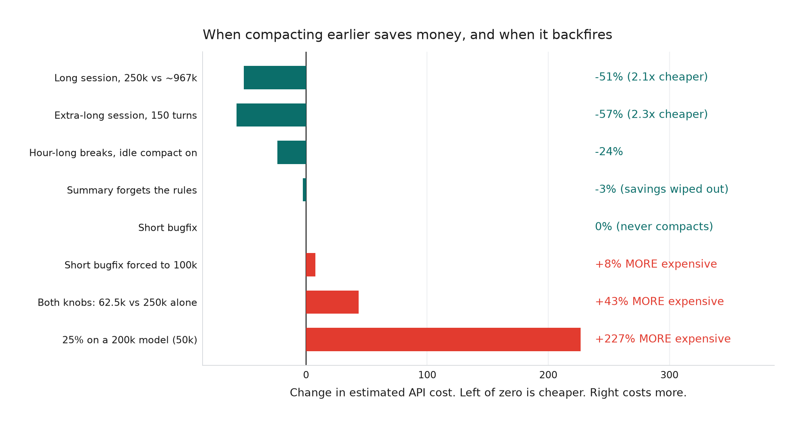

# Claude Code Compaction Study

*Does compacting context earlier actually save Claude usage, or can it quietly raise your bill?*

## The goal

Every turn in Claude Code re-sends your conversation history, and native 1M-token models let a thread grow to ~967k tokens before auto-compacting. **Hypothesis:** lowering that auto-compaction trigger (say to 150k-250k tokens) should cut redundant context growth in long sessions, **but** prompt caching already discounts repeated history by 90-95% and compacting has a fixed overhead, so compacting too aggressively or in the wrong workflow could erase the savings or even cost *more*. This repo provides a caching simulator, a 10-second offline analyzer for your own `~/.claude/projects` logs, and a benchmark suite to test where early compaction helps and where it backfires.

## Key takeaways

1. **It cuts real cost by ~2x on long sessions (not 4x, and never more).** Lowering the trigger from ~967k to 250k sends **67% fewer prompt tokens** (`3.1x`), which translates to **51% lower API-equivalent cost** (`2.1x`) at standard cache-read pricing, or **41% lower** on Opus 5.5 / Sonnet 5.5 (`0.05x` reads). Prompt caching softens the penalty of large context.
2. **The sweet spot is ~150k-200k tokens, not a blind "25%".** At Opus 5.5 / Sonnet 5.5 read prices (`0.05x`), cost bottoms out around **160k tokens** (**43% cheaper** than default); at standard `0.1x` reads it bottoms out around **120k tokens** (**57% cheaper**). Below ~100k, summary rebuild costs spike your bill.
3. **The hidden traps that actually INCREASE your bill:** Setting *both* a `250k` window *and* a `25%` override multiplies them to **62.5k tokens** (158 compactions instead of 10), making your session **+43% MORE expensive** than `250k` alone. Worse, applying `25%` on a 200k-context model triggers at **50k** and **more than triples your cost (+227%)**.
4. **Short fixes save 0%, and losing context wipes out the rest.** Short debugging sessions never reach 250k (`0%` saved), forcing `100k` costs **+8% more**, and if a summary forgets key project rules and costs ~15 repair calls, net savings collapse to **3%**.

*Numbers below come from our reproducible caching model; local transcript measurements and live benchmark runs are cleanly separated and ready for you to run on your own machine.*

## The 2x, on one session

The long-session result is 60 messages, 8 model calls each, 4,000 new tokens and 600 tokens of output per call, on a warm cache. The default grows to about 967k and compacts twice. At 250k it compacts 10 times. Same work.

| | Default, about 967k | Early trigger, 250k |
| --- | ---: | ---: |
| Prompt tokens | 222,160,000 | 72,881,600 |
| Estimated API cost | 28,033,460 | 13,626,420 |
| Compactions | 2 | 10 |

Take four long breaks and leave idle compaction on, which recent Claude Code does by default once you are past 200k, and that cost gap shrinks to 24%. The big session gets summarized while its cache is still warm.

Dividing 967 by 250 suggests a 3.9x drop. That shortcut ignores the summary calls, the context you keep, and the cache.

## The picture



Teal bars are cheaper. Coral bars cost more. The long session is the win. The two traps on the right are the bill.


Cost bottoms in a valley. 25% of a 1M window (250k) sits past it. Below 100k the curve turns up.


Same work, two triggers. Caching is why a 67% drop in prompt tokens becomes about a 51% drop in cost.

## What the charts are saying

A long thread keeps re-sending itself. Most of that repeated history is a cheap cache read, which is why cutting the prompt by two thirds only cuts the estimated bill in half. The saving shows up when the thread is actually long. It does not show up on a short bugfix, and it shrinks to almost nothing if the summary drops a rule and the agent has to rediscover it.

The expensive mistakes are the ones that look thrifty. Two settings that each sound like "about 250k" multiply into a 62.5k trigger and compact all afternoon. On a 200k model, "25%" is 50k, and the summary overhead more than triples the estimated cost.

## Copy one knob, not two

Pick one. On a 1M model, either of these sits near the valley:

```bash
CLAUDE_AUTOCOMPACT_PCT_OVERRIDE=20 claude
```

```bash
claude --autocompact 180000
```

Do not set both. A 250k window plus a 25% override is a 62.5k trigger.

Then:

- Use `/clear` between unrelated tasks. That reset is free. Compaction is for a thread you still need.
- Put unbreakable rules in root `CLAUDE.md`. A summary re-injects that file. It does not reliably keep a rule that lived only in the chat.
- After a week, read `preTokens` on the compaction events. The label in the UI is not the boundary.

## Check your own logs in 10 seconds

Python 3.11+. The analyzer prints aggregates only. It never copies prompt text. With `--output` or `--summary` it also prints a one-screen scorecard.

```bash
python3 -m pip install -e ".[dev]"
python3 -m cc_usage_study.analyze ~/.claude/projects --split-date YYYY-MM-DD --sessions --output outputs/local-report.json
python3 -m cc_usage_study.simulate --out outputs
```

Replace the date with the day you changed the setting. CLI logs older than 30 days may already be gone. Desktop and Cowork transcripts are kept. `python3 -m pytest -q` checks the model against these charts.

The scorecard on stderr is the shareable bit: sessions, main calls, compactions, how much of the prompt was a cache read, prompt tokens per call, and the before/after change when you pass a date. The JSON file is the full aggregate. Neither one contains your prompts.

## What a real log can confirm

The charts above are the model. Your transcripts answer a different question: did *your* sessions actually hit the trigger?

- Prompt tokens per main call should fall if the lower trigger fired on long threads.
- A short week of bugfixes can show no change at all. That matches the 0% bar.
- `preTokens` tells you the real boundary. If you set both knobs, expect a number near 62,500, not 250,000.
- Compactions going through the roof, with prompt tokens per call barely down, is the 50k trap.
- The five-hour meter is not in the file. Copy the percentages from Settings > Usage for the same blocks. A token win that does not move the meter is still a finding.

Company logs can contain source code even when the report does not. Run the analyzer only where that is allowed. The safe demo is `fixtures/synthetic/`. Reports from it are marked synthetic.

## What's inside

| | |
| --- | --- |
| `docs/article-draft.md` | The public essay: why ~2x, and where it backfires |
| `docs/examples.md` | The arithmetic, request by request |
| `docs/reference.md` | Knobs, model windows, caching, idle compaction |
| `outputs/` | Every chart and the number behind it |
| `benchmarks/` | How to test a real task without fooling yourself |
| `fixtures/synthetic/` | Fake transcripts for the analyzer. Not real usage. |

## License

MIT. See `LICENSE`.
