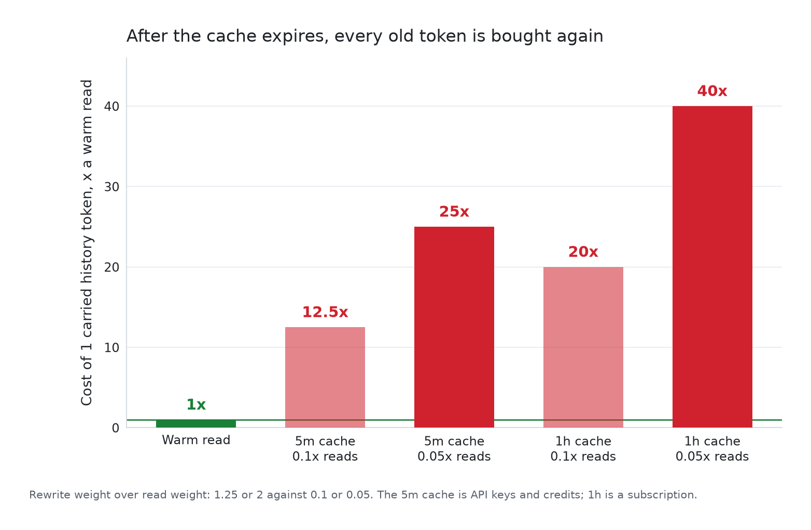

# Your Claude Code coffee break costs 10x

**Come back to a big session after a 10-minute break, resume it, and the next fix uses about 10 times what a fresh `/clear` start uses.** We measured it on real Claude Opus 5.5 runs.


## The rules

- **Leaving for a break?** [`/compact`](https://code.claude.com/docs/en/commands) first. The next fix used 2.5x a fresh start, compact call included, not 10x.
- **Back after a break?** [`/clear`](https://code.claude.com/docs/en/commands) and paste a 3-line handoff. Resuming used ~10x more, and so did `/compact` after the break.
- **Quick related fixes back to back?** Stay in the session. It used 28% less than `/clear` between each.
- **Scheduled `claude -p` jobs?** Fresh session every run, state in a file. `--resume` costs ~3x (modeled).
- **Long session headed past 300k tokens?** `claude --autocompact 180000`. About 43% less (modeled).
- **Pick the plain CLI.** The same fix used 1.19x in T3 Code and 1.80x in Claude Desktop's Code tab.

"Break" means longer than the [prompt cache](https://code.claude.com/docs/en/prompt-caching): **5 minutes** on an API key or usage credits, **1 hour** on a subscription within its [usage limits](https://support.claude.com/en/articles/11145838-use-claude-code-with-your-pro-max-or-ultra-plan).

## Copy-paste

```bash
# Deep work on a 1M model: compaction fires at 147,000. Shorter sessions: change nothing.
claude --autocompact 180000

# Cron and CI: start fresh every run, keep state in a file
claude -p "$(cat .agent/handoff.md) Continue the nightly triage." --output-format json
```

```text
# Before a break
/compact Keep: the open issue, files touched, test command

# Back after a break, new task
/clear
Goal: fix the currency rounding in invoices.
Done: tests in tests/test_invoice.py reproduce it.
Next: patch money.py, run the suite.
```

**[How we measured](#how-we-measured)** · [the coffee-break test](#1-the-coffee-break-tax) · [`/compact`](#compact-before-or-after-the-break) · [compaction](#2-compaction-measured-live) · [clients](#4-three-clients-one-bugfix)

---

## How we measured

Every number is either **measured** from the raw session logs of 14 live Opus 5.5 runs plus a 9-run cache-expiry test and a 5-run `/compact` test (`outputs/live_experiments.json`), or **modeled** by the caching simulator in `src/cc_usage_study/` (`outputs/summary.json`). No live API calls are needed to check any of it.

> **Units.** "Usage" is **cache-weighted usage**: tokens weighted the way the API meters them, on Opus 5.5 `1 / 1.25 / 2 / 0.05 / 5` (input / 5-minute cache write / 1-hour cache write / cache read / output). Read weights differ by model (0.1x on Sonnet 5 and Opus 4.7, 0.025x on Fable and Mythos), so results are also given across that range where it moves the answer. The subscription's five-hour and weekly meter is **not measured**: Anthropic does not publish its weights.

**Honest limits.** Most live conditions ran once (n=1; the `/compact` test ran 2 and 3 times), on one model, with small tasks and a 5-minute cache. The breaks were 10 to 13 minutes, so a break just past 5 minutes was not measured. Two of the five compaction arms failed the repo's own validity gate. The 1-hour cache, cron and sweet-spot numbers are modeled.

| Claim | Source | Status |
| --- | --- | --- |
| Stale resume after 10+ min about 10 times a fresh start; warm resume with 97k history 1.5 times | `ttl_runs` | Measured: 3 stale and fresh pairs, 1 warm run |
| `/compact` before a break 2.5 times a fresh start, after a break about 10 times | `compact_runs` | Measured: 3 before, 2 after, same fixes as `ttl_runs` |
| Warm session -27.7% against `/clear` | `clear_vs_warm` | Measured, n=1, tiny history |
| Hidden summary usage 11.8% to 25.5%; lower triggers tie or lose on a ~270k session | `compaction`, 5 arms | Measured, n=1, no pauses, two arms fail the 15% gate |
| Client multipliers 1.19x and 1.80x | `client_comparison` | Measured, n=1. Desktop is a floor |
| Trigger formula and idle-compaction conditions | Claude Code v2.1.325 binary | Read from the binary, checked against live `preTokens` |
| Pause curves, cron, 1-hour cache, workflow sweet spots | `outputs/summary.json` | Modeled |

### Anthropic docs

- [Prompt caching in Claude Code](https://code.claude.com/docs/en/prompt-caching): which requests get the 5-minute or 1-hour TTL, and how to choose it
- [Prompt caching on the API](https://platform.claude.com/docs/en/build-with-claude/prompt-caching): cache lifetime, 1-hour cache, write and read multipliers ([pricing](https://platform.claude.com/docs/en/about-claude/pricing))
- [Manage costs in Claude Code](https://code.claude.com/docs/en/costs) and [context window](https://code.claude.com/docs/en/context-window)
- [Commands](https://code.claude.com/docs/en/commands): `/compact`, `/clear`, `/usage`
- [Claude Code with a Pro, Max or Ultra plan](https://support.claude.com/en/articles/11145838-use-claude-code-with-your-pro-max-or-ultra-plan) (five-hour and weekly limits) and [usage limit best practices](https://support.claude.com/en/articles/9797557-usage-limit-best-practices)
- [API rate limits](https://platform.claude.com/docs/en/api/rate-limits)

### 1. The coffee-break tax

Claude Code [caches the prompt prefix](https://code.claude.com/docs/en/prompt-caching) ([API caching docs](https://platform.claude.com/docs/en/build-with-claude/prompt-caching)). Inside the cache window a resumed session re-reads its history at the cheap read weight. After the window, every old token is **written to the cache again** at full write weight.

We built a session to about 97k tokens (5-minute cache), walked away for 10 to 13 minutes, and resumed it for a quick bugfix. Each time we also ran the same fix in a brand-new session. Three different fixes, all passed their tests.

| Same quick fix | Fresh (`/clear`) | Resumed after 3.3 min | Resumed after 10+ min |
| --- | ---: | ---: | ---: |
| Usage, fresh = 1 | **1** | **1.5 times** | **9.8 to 9.9 times** (3 of 3) |
| Across models' read weights | 1 | 1.0 to 2.3 times | 9.0 to 10.5 times |
| First call: tokens written to cache | about 5,500 | 743 | 86,178 to 88,229 |
| Raw tokens for the whole fix | about 52,000 | 293,834 | 294,158 to 301,452 |

- The warm and stale resumes moved almost the same tokens (294k) but the stale one used 6.5 times more. Token counts alone would call them a tie.
- Even warm, 97k of history was too much to drag into an unrelated small fix. The model says a warm resume only pays while history is under about 24k tokens.
- A bigger next task would shrink the multiple, because the fresh session's own work would weigh more. The extra cost per carried token (about 1.4 units) does not shrink.

#### `/compact` before or after the break

We also tried [`/compact`](https://code.claude.com/docs/en/commands) on the same ~97k-token sessions, then the same quick fix. Headless it is just `claude -p "/compact Keep: the 3 issues found, files touched, test command" --resume SESSION`; the transcript gets a `compact_boundary` with `trigger: manual`.

| Same quick fix, fresh `/clear` = 1 | `/compact` call | Next fix | Total |
| --- | ---: | ---: | ---: |
| `/compact` right away (cache warm), then a 6.5 to 11 min break, n=3 | 1.1 to 1.2 | 1.3 | **2.5 times** (2.49 to 2.53) |
| Break first (cache cold), then `/compact`, n=2 | 8.0 to 8.8 | 1.2 to 1.5 | **9.3 and 10.2 times** |
| Plain resume after the break (`ttl_runs`) | none | 9.8 to 9.9 | **9.8 to 9.9 times** |

- **Before the break it is cheap:** the summary call re-reads the 96k history from the warm cache. After the break the model rebuilds only the summary (about 21k of context against 17.8k fresh).
- **After the break it saves nothing on the next fix:** the summary call sends the whole cold history again (87k to 90k uncached input tokens), about the same as just resuming. It only pays on later turns.
- `/clear` plus a handoff is still the cheapest for an unrelated fix. `/compact` keeps the thread. The compact call is not in the transcript as an assistant row; its tokens come from Claude Code's `cost_state`. Across models' read weights: before 2.4 to 2.6 times, after 8.5 to 10.6 times.




Modeled 5-call next task: a stale resume loses to a fresh start once history passes **about 10k tokens**, even if the fresh session needs 2 extra exploration calls (8.3k on the 1-hour cache). A warm resume wins while history times remaining calls stays under about 120k token-calls at 0.05x reads (about 57k at 0.1x). The diamonds are the live runs.


**Scheduled jobs are the worst case (modeled).** Twelve `claude -p` runs spaced past the cache window: with `--resume`, 11 of 11 resumes rebuild the whole growing history cold. Fresh runs use **33%** of that on the 1-hour cache and **35%** on the 5-minute cache.

### 2. Compaction, measured live


Same task in every arm: **LedgerKit v3.2**, a 24-module migration over 4 `--resume` phases. Opus 5.5, effort medium, 5-minute cache, no long pauses, n=1 per arm. Green is what the transcript shows; red is summary traffic that only appears in Claude Code's own `cost_state` total.

- **Fewer tokens is not less usage.** The 100k arm sent 63% fewer raw tokens (2.27M against 6.12M) and used 25.2% more. Most of the default's tokens were cheap cache reads.
- **Part of the cost is invisible.** Summary calls were 11.8% to 25.5% of each compacting arm, about 36.6k units per compaction on average.
- **The ranking depends on read weight.** At 0.1x reads the 180k arm comes out 13.6% under the default. The ~270k tie also assumes no pauses: one pause past the cache at ~260k of history would add roughly 39% to the default arm (modeled).
- Quality held everywhere: all 5 arms passed the tests and the functional checker and reported 12/12 planted anomalies.

<details>
<summary>Per-arm table</summary>

| Arm | Fires at | Compactions | Usage, default = 100 | Hidden share | Raw tokens vs default | At 0.1x reads | At 0.025x reads | 15% `preTokens` gate |
| --- | ---: | ---: | ---: | ---: | ---: | ---: | ---: | --- |
| Default 1M | 967,000 | 0 | **100** | 0% | 6.12M tokens | 100 | 100 | no fire |
| `--autocompact 180000` | 147,000 | 2 | **100 (tie, +0.1%)** | 11.8% | -48% | -13.6% | +11.6% | fails (+15.7%) |
| 250,000 window + override 25 | 57,500 | 6 | **+13.6%** | 24.3% | -70% | -10.2% | +33.5% | fails (+55.5%) |
| `--autocompact 140000` | 107,000 | 4 | **+18.1%** | 13.9% | -42% | +1.0% | +32.5% | passes |
| `--autocompact 100000` | 67,000 | 7 | **+25.2%** | 25.5% | -63% | +0.1% | +46.2% | passes |

The ordering is not monotonic at n=1 (57,500 beat 107,000 and 67,000), so "a lower trigger pays past a break-even length" is a model claim.

</details>

### 3. `/clear` vs a warm session


Three quick fixes back to back, n=1. Three fresh sessions against one session resumed inside the cache window. The warm session read 7.0% more raw tokens but rebuilt 53% fewer, so it used **27.7% less** (21.1% to 32.0% by model). Context peaked at 20,265 tokens: this only holds while history is small.

### 4. Three clients, one bugfix


Same Opus 5.5, effort medium, identical 3-line `CLAUDE.md`, no user MCP servers, n=1 per client. All three fixed all 3 planted bugs.

| | CLI interactive | T3 Code | Desktop Code tab |
| --- | ---: | ---: | ---: |
| First request, tokens | 19,528 | 22,842 | 39,749 |
| Inline / deferred tools | 14 / 15 | 15 / 82 | 35 / 82 |
| Fix usage vs CLI | 1.00x | **1.19x** (1.17x to 1.20x by model) | **1.80x** (1.71x to 1.92x by model) |

T3 Code runs Claude Code through the Agent SDK and adds 67 deferred tools plus a longer system prompt. Desktop's Code tab carries a whole app (35 inline tools, 3.5 times the system prompt) and writes no `cost_state` row, so its number is a floor. Full table: `benchmarks/client_comparison.md`.

### 5. Where compaction actually fires

Read from the Claude Code v2.1.325 binary (`tle` and `WX`). The number you type is not where it fires: **subtract 33,000, and never stack two knobs.**

```text
effective_window = window - min(maxOutputTokens, 20000)
threshold        = effective_window - 13000                                    # no override
threshold        = min(floor(effective_window * pct / 100), effective_window - 13000)   # with CLAUDE_AUTOCOMPACT_PCT_OVERRIDE
```

| You set | It fires at |
| --- | ---: |
| nothing, 1M window | 967,000 |
| nothing, 200k model | 167,000 |
| `--autocompact 180000` | 147,000 |
| `CLAUDE_AUTOCOMPACT_PCT_OVERRIDE=18`, 1M window | 176,400 |
| `--autocompact 100000` | 67,000 |
| 250,000-token window and `CLAUDE_AUTOCOMPACT_PCT_OVERRIDE=25` | 57,500 |

**Idle compaction** summarizes a big session at about 90% of the cache window, before it expires. It only runs when all of these hold: `idleCompaction` is on (default since v2.1.299), the session is on the **1-hour** cache (never on API keys), the **process is still alive** (not a sleeping laptop or a finished `claude -p`), and context is at least `CLAUDE_CODE_IDLE_COMPACT_MIN_TOKENS` (**200,000** by default, 100,000 at the lowest). `--autocompact 180000` keeps you under 200,000, so pair it with `CLAUDE_CODE_IDLE_COMPACT_MIN_TOKENS=100000` if you take long breaks with the terminal open.

### 6. Sweet spots by workflow (modeled)

On a 1M model, deep work wants compaction to fire somewhere in 150k to 200k (type about 183,000 to 233,000). Short work wants nothing changed.


<details>
<summary>Workflow and pause-trap tables</summary>

| Workflow | Best fire point | You type | Usage vs that workflow's default |
| --- | ---: | ---: | ---: |
| Deep feature work, 0.1x reads (Sonnet 5, Opus 4.7) | 120k | 153,000 | **-57%** |
| Deep feature work, Opus 5.5 / Sonnet 5.5 | 160k | 193,000 | **-43%** |
| Marathon refactor, 150 turns, smaller steps | 130k | 163,000 | **-54%** |
| Heavy file reads, big working memory | 280k | 313,000 | **-24%** |
| Rules that live only in the chat, 8 repairs per compact | 360k | 393,000 | **-24.9%** |
| Workday with long breaks, idle compaction ran | 140k | 173,000 | **-18%** |
| Quick bugfix | no trigger is reached | leave it | 0%, or **+8%** if forced to fire at 100k |
| 200k-context model | leave the 167,000 default | leave it | **+239%** with override 25 (fires at 45,000 and thrashes) |

| Trap | Against | Usage |
| --- | --- | ---: |
| Lunch breaks, laptop slept, idle compaction lapsed | the same day with idle compaction running | **+76%** |
| API key, 7-minute gaps past the 5-minute cache | the same session answered within 2 minutes | **+213%** |
| Stale `--resume` with 60k of history | `/clear` plus a handoff, 2 extra exploration calls | **+102%** |
| Hourly `claude -p` with `--resume` | a fresh session every run | **+201%** |

</details>


The Opus 5.5 curve is flat from 140k to 200k, within a point of its -43% floor. Cheaper reads move the valley right. Under 100k, summaries cost more than they save. The closed form `T* = R + sqrt(2K(g + o)/r)` agrees with the grid; a K calibrated to the live compactions moves the Opus 5.5 valley about 10k right, still inside the band.


Raw prompt tokens fall about 77% at a 160k fire point, but cache-weighted usage only about 43%, because most of the default's tall curve was a cheap warm read.

### Reproduce

```bash
python3 -m pip install -e ".[dev]"
python3 -m cc_usage_study.analyze ~/.claude/projects --split-date YYYY-MM-DD --sessions --output outputs/local-report.json
python3 -m cc_usage_study.simulate --out outputs
python3 -m cc_usage_study.experiments figures --out outputs
python3 -m pytest -q
```

The analyzer copies aggregates only, never prompt text. Read `preTokens` on your first `compact_boundary`: if it does not match the table in section 5, your setting is not the one you think.

<details>
<summary>Setup and what's inside</summary>

- Clients: Claude CLI v2.1.325, T3 Code v0.1.9 (Agent SDK wrapping Claude Code v2.1.325), Claude Desktop v5.1231.2 (Code tab, bundled Claude Code v2.1.321).
- Model `claude-opus-5-5`, effort `medium`, 1M context, `maxOutputTokens` 128,000.
- Cache-weighted units are the logged list-price cost divided by the Opus 5.5 input price. Pricing snapshot 13 November 2026, [pricing page](https://platform.claude.com/docs/en/about-claude/pricing).
- "Hidden" usage is `cost_state.totalCostUSD` minus the deduplicated assistant rows in the same transcript.
- The JSON holds numbers only: no prompt text, no tool output, no keys, no local paths.

| | |
| --- | --- |
| `outputs/live_experiments.json` | All live runs, sanitized |
| `outputs/summary.json` | Every modeled number |
| `src/cc_usage_study/` | Extractor, caching model, simulator, charts |
| `benchmarks/protocol.md` | How the live runs were set up, and the validity gate |
| `benchmarks/client_comparison.md` | The full client table |
| `docs/reference.md` | Knobs, model windows, caching, the traps |
| `docs/examples.md` | The arithmetic behind a single session |
| `docs/article-draft.md` | The long-form essay |

</details>

## Credits

Co-produced by Grok 4.7 and Claude Fable 5.2: AI-assisted research and writing, with Fable 5.2 reviewing and critiquing the analysis. Live experiments ran on Claude Opus 5.5.

## License

MIT. See `LICENSE`.
